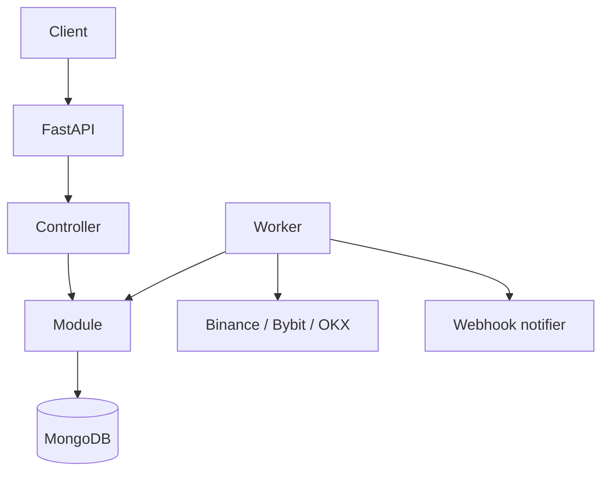

# crypto-signals-with-grok-bot

Scans crypto markets with Miguel's **time@mode** rules, stores the signals, and alerts him. The rules cover trend and modes, mode expiry, ATR and expansion-candle confirmations, bias flips, the timeframe ladder, trading blocks, the 70 SMA filter, and exits. Spot is the first market. Futures uses the same rules later. Arbitrage is a reserved module: the notes do not describe it yet.

A working Python scanner already exists. It is copied under [`prototype/`](prototype/) and is the reference for detection. This repository is the planning foundation and a runnable skeleton. The detector is not wired into the API yet.

## Architecture

FastAPI for the HTTP API, MongoDB for storage, and a separate worker process for the scan. The layout follows verifik-backend's Repositories pattern: each domain is a folder under `Repositories/` with `controllers/`, `models/`, `modules/`, `routes/`, `middlewares/`, `helpers/`, and `tests/`. Shared infrastructure is `Core/`. The request path is route → middleware (auth and Pydantic) → controller → module → model. Modules do not call other modules. Mongo reads go through `Core.mongo_orm.build_query`.



The worker loads a watchlist and the time@mode parameters, fetches **closed** candles, runs the pure detector, upserts signals by a deterministic id, and hands new signals to a pluggable notifier. The first notifier is a webhook. `prototype/state.json` is replaced by a unique index on `signal_id`.

Libraries:

- **FastAPI** and **Pydantic v2** for the API and validation.
- **Motor** as the async Mongo driver, and **Beanie** as the document layer (the Mongoose equivalent: fields, indexes, timestamps). Modules still read only through the shared query helper, which speaks the same filter vocabulary as verifik's `mongo-orm`.
- **httpx** behind `Core.http_client` when the fetch is ported.
- **APScheduler** is the planned worker scheduler. It is not a dependency until the scanner port.

Details, the verifik mapping, and the request flow are in [docs/architecture.md](docs/architecture.md).

## Layout

```text
app/                      FastAPI app, worker, document registry
Core/                     config, database, mongo_orm, errors, http, auth
Repositories/
  MarketData/             candle fetch and optional cache
  Exchanges/              ordered public kline sources
  Strategies/TimeMode/    pure time@mode rules and parameters
  Signals/                signals and scan runs
  Watchlists/
  Alerts/                 delivery records and the Notifier interface
  Backtests/
  Arbitrage/              reserved, no rules yet
  Futures/Positions/      reserved
prototype/                the reference scanner, unchanged in behavior
docs/                     planning docs
.cursor/rules/            repository convention for agents
```

Each active domain folder contains `controllers/`, `models/`, `modules/`, `routes/`, `middlewares/`, `helpers/`, and `tests/`.

## Planning docs

| Doc | What it decides |
| --- | --- |
| [docs/architecture.md](docs/architecture.md) | Layers, Repositories pattern, request flow, worker, query builder |
| [docs/data-model.md](docs/data-model.md) | Collections, fields, indexes |
| [docs/api-spec.md](docs/api-spec.md) | Endpoints, including what the skeleton actually serves |
| [docs/strategy-spec.md](docs/strategy-spec.md) | time@mode as implementable rules, the 18/23 baseline, open questions |
| [docs/roadmap.md](docs/roadmap.md) | Phases from the scanner port through a later UI |
| [docs/environments.md](docs/environments.md) | `development` / `staging` / `production`, env vars |
| [docs/coding-conventions.md](docs/coding-conventions.md) | How code is written in this tree |
| [docs/testing-strategy.md](docs/testing-strategy.md) | What is tested now and after the port |

Source notes, copied in as reference: [docs/references/time-mode-strategy-rules.md](docs/references/time-mode-strategy-rules.md) and [docs/references/chart-analysis.md](docs/references/chart-analysis.md).

## Local setup

Python 3.12. MongoDB is the planned database and is **not** required to boot the skeleton.

```bash
python3 -m venv .venv
source .venv/bin/activate
pip install -e ".[dev,scanner]"
cp .env.example .env
```

`scanner` installs numpy for the prototype. The API skeleton does not import it.

Environment variables are listed in `.env.example`. The ones that matter locally:

| Variable | Role |
| --- | --- |
| `APP_ENV` | `development` allows an empty `API_KEY` |
| `API_KEY` | `X-API-Key` for `/api/v1`. Empty only in development |
| `MONGODB_URL` | Default `mongodb://localhost:27017` |
| `MONGODB_DB` | Default `crypto_signals` |
| `API_PORT` | Default `8000` |
| `SCAN_INTERVAL_SECONDS` | Planned worker interval, default `900` |

A local Mongo 7.x is enough when a later phase connects. Example: `docker run -d --name crypto-signals-mongo -p 27017:27017 mongo:7`.

## Run

API:

```bash
uvicorn app.main:app --host 0.0.0.0 --port 8000
```

`GET /health` returns `status: ok`. Interactive docs are at `/docs`.

Worker (skeleton: it does not scan):

```bash
python -m app.worker --once
```

Tests:

```bash
ruff check app Core Repositories tests
pytest
```

Prototype scanner, from the copied reference (needs network and numpy):

```bash
python3 prototype/scan.py --symbols BTCUSDT --timeframes 1d,1w
python3 prototype/validate.py
```

`validate.py` is the chart replay. The checked-in result is 18 of 23. See [docs/strategy-spec.md](docs/strategy-spec.md).

## Branches

`development`, `staging`, and `production` are long-lived branches cut from `main`. Feature branches open pull requests into `development`. Promotion is `development` → `staging` → `production`. The same code runs everywhere; `APP_ENV`, `API_KEY`, and `MONGODB_URL` differ. `main` stays the GitHub default and is not where app work lands. More in [docs/environments.md](docs/environments.md).

## What this pass does not do

It does not port detection, write to Mongo, send alerts, or ship a UI. Those are roadmap phases 1 through 7. Open questions for Miguel are collected in [docs/strategy-spec.md](docs/strategy-spec.md).
