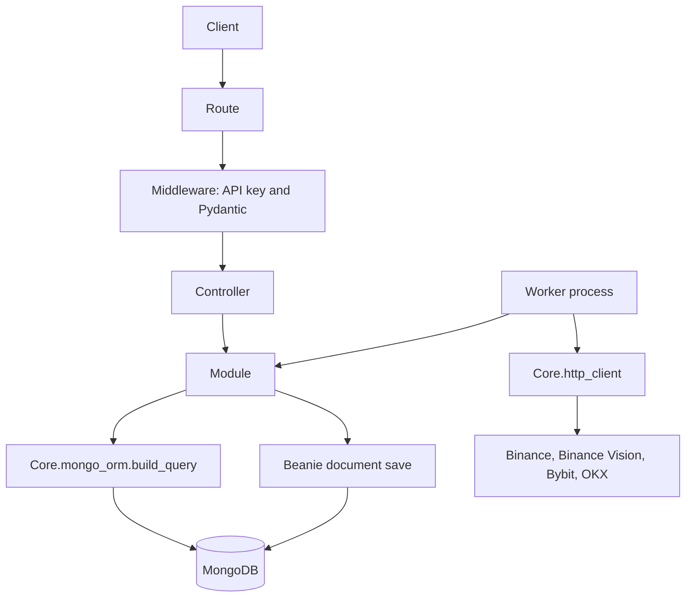
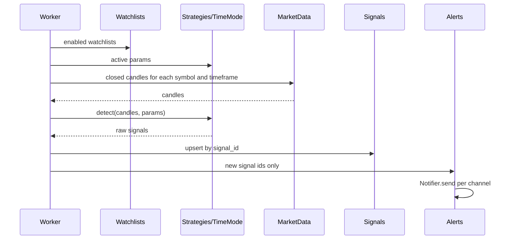

# Architecture

crypto-signals-with-grok-bot is a Python service that scans crypto markets with Miguel's time@mode rules, stores the signals, and sends alerts. This document is the planning architecture. The detection rules themselves are specified in [strategy-spec.md](strategy-spec.md). The folder layout is the one to build into; most of the files in this pass are placeholders.

## Stack

| Concern | Choice | Why |
| --- | --- | --- |
| Language | Python 3.12 | The working scanner is Python, and the whole app stays in one language. |
| API | FastAPI | Async, first-party Pydantic validation, and `APIRouter` maps onto verifik-backend's per-domain route files. |
| Validation | Pydantic v2 | Same role as the Joi checks in verifik middleware. |
| Mongo driver | Motor 3.x | Official async driver. Fits FastAPI and the worker without blocking the event loop. |
| Documents | Beanie 2 (on Motor) | Closest thing to Mongoose: document classes, field types, indexes, and timestamps, defined with Pydantic. PyMongo alone would be untyped dicts. Motor alone is the same, only async. |
| Reads | `Core.mongo_orm.build_query` | Same rule as verifik: modules do not invent their own queries. Beanie's `find` API is not the read path. |
| HTTP client | httpx, behind `Core.http_client` | Async, and one place to add timeouts and retries when the exchange fetch is ported. |
| Worker schedule | APScheduler, inside the worker process | One interval job. Celery and Redis are not justified until there is a real queue of work. Not a dependency in this pass. |
| Alerts | A `Notifier` protocol, webhook first | New channels are new classes. The scan does not know about HTTP. |

PyMongo is the library Motor wraps. Application code does not construct a synchronous `MongoClient`.

Beanie is the model layer only. A module that needs documents calls `Core.mongo_orm.build_query(params, Signal, allowed_populates)` for reads, and calls `save()` on a Beanie document for inserts and updates. That split is the same one verifik uses: mongoose models for shape and writes, `mongo-orm.buildQuery` for reads.

## How this maps onto verifik-backend

verifik-backend (Koa, Mongoose) groups each domain under `Repositories/<Domain>/` and shares infrastructure in `Core/`. Their rule is: use the existing repository pattern, use Core to avoid duplication, send every read through `mongo-orm`, and call modules from controllers rather than from other modules. This repo keeps that rule. The example they sent (`APIRequestFilter` plus `Core/mongo-orm.js`) is the template for a domain.

| verifik-backend | this repo |
| --- | --- |
| `server.get(path, Middleware.getValidation, Controller.get)` | `APIRouter` route with `Depends(middleware model)` then a controller function |
| Joi (or empty) middleware | Pydantic model in `middlewares/` |
| `*.controller.js` try/catch and response shape | `*_controller.py` plus the shared error handler in `Core.errors` |
| `*.module.js` business logic | `*_module.py` |
| Mongoose schema in `*.model.js` | Beanie `Document` in `*_model.py` |
| `MongoORM.buildQuery(params, Model, null, allowedPopulates)` | `Core.mongo_orm.build_query(params, model, allowed_populates)` |
| `HttpHandler.errorHandler` → `{message, code}` | `AppError` → `{message, code}` |
| `Core/config.js` | `Core/config.py` (pydantic-settings) |
| `Core/database.js` | `Core/database.py` (Motor client; Beanie init receives the model list) |
| `Core/axios.js` | `Core/http_client.py` |
| `Core/cache.js` | `Core/cache.py` |
| `ctx.state.user` and `authUser.clientId` | Not ported. One shared API key. See below. |
| Kebab-case filenames (`api-request-filter.module.js`) | Snake-case filenames (`signal_module.py`), because Python modules cannot use hyphens |

Domain folders stay PascalCase (`Repositories/Signals`), matching verifik.

### What we are not copying

verifik is multi-tenant: almost every read adds `where_client` from `authUser.clientId`. This app is Miguel's scanner. There is no client, user, or account collection in the plan. Protected routes check a single `X-API-Key` (`Core/auth.py`). When `APP_ENV=development` and `API_KEY` is empty, the check is skipped so local use needs no secret. Staging and production must set `API_KEY`; a protected route returns 500 `server_misconfigured` if they do not. A users collection can be added later without moving domains around. That is an open product question, not a hidden tenant filter.

## Layers



The worker is a second composition root. It is allowed to call modules the same way a controller is. A module must not import another domain's module.

Planned scan, once phase 1 fills the stubs in:



`Strategies/TimeMode` is a pure function of candles and params. It does not fetch, and it does not write. `MarketData` fetches and, later, may cache candles. `Signals` persists. `Alerts` delivers. The worker passes data between them. That is what keeps the "no module-to-module calls" rule intact.

## Request flow

Same responsibilities as `api-request-filter.route.js` → middleware → controller → module → model.

1. **Route** (`routes/`). Declares the method, path, and which middleware dependency runs. No logic.
2. **Middleware** (`middlewares/`). Auth dependency plus a Pydantic model for query or body. Rejects a bad request before the controller. This replaces Koa's middleware chain.
3. **Controller** (`controllers/`). Calls one or more modules. Shapes the HTTP body. Does not catch errors locally; `AppError` and unexpected exceptions are handled in `Core.errors`.
4. **Module** (`modules/`). Business logic. Reads only through `build_query`. Writes with the domain model. Raises `AppError` for expected failures (`404` / `not_found`, `409` / `conflict`).
5. **Model** (`models/`). Beanie document: fields, types, indexes, collection name. No request objects.

List responses use the verifik envelope, built by `Core.http.list_response`:

```json
{"data": [], "total": 0, "limit": 20, "page": 1, "pages": 0}
```

Single-document responses are `{"data": ...}`. Updates and deletes add `"status": "completed"`. Domain errors are `{"message": "...", "code": "..."}` with the HTTP status on the response. Request-validation failures stay FastAPI's 422 `detail` list, because that payload is produced by Pydantic before the controller. Unhandled exceptions are logged and returned as 500 `internal_error` with a fixed message; the exception text is not sent to the client.

### Public filters vs the query builder

verifik often forwards the raw query string into `buildQuery`, so callers pass `where_symbol` and `in_type` themselves. This API does not. Public query params are explicit (`symbol`, `timeframe`, `page`, `limit`, `sort`) and validated by Pydantic. The module translates those into the `build_query` vocabulary. Two reasons: the public contract stays documented and stable, and the query builder is not an injection surface on the URL.

`build_query` still accepts verifik's parameter names, so module code can look like their modules. Planned keys:

| Param | Meaning |
| --- | --- |
| `where_<field>` | equality |
| `wherenot_<field>` | `$ne` |
| `where>_<field>`, `where>=_<field>`, `whereGTE_<field>` | `$gt`, `$gte` |
| `where<_<field>`, `where<=_<field>`, `whereLTE_<field>` | `$lt`, `$lte` |
| `in_<field>`, `notIn_<field>` | `$in`, `$nin` |
| `like_<field>`, `notLike_<field>` | substring match, case-insensitive |
| `prefix_<field>` | anchored prefix match |
| `where-null_<field>`, `where-not-null_<field>` | null / present |
| `where-exists_<field>` | `$exists` |
| `where-case-insensitive_<field>` | full-string match, case-insensitive |
| `findOne` | one document |
| `page`, `limit` or `perPage`, `offset`, `skipTotal` | page envelope; default limit 20 |
| `sort` or `sortBy` + `sortOrder` | `-field` is descending, as in mongoose |
| `select` or `columns` | projection |
| `populates` | relation load, only names in the module's allow-list |
| `count`, `sum` | aggregate reads |
| `lean` | plain dicts |

Date-only `YYYY-MM-DD` on `$lte` / `$lt` should cover the UTC day, matching verifik. Field names are restricted to letters, digits, underscore, and dot. `like_`, `notLike_`, and `prefix_` must escape regex metacharacters (verifik escapes `prefix_` only; we escape all three on purpose). `__match` from their parser is not part of our public or module API; it would let a caller inject raw operators.

`build_query` raises `NotImplementedError` in this pass. The list routes return an empty page without touching Mongo, so the process starts with no database. Phase 1 replaces those module bodies with real `build_query` calls. Modules must not grow a private `collection.find` in the meantime.

Populates are allow-listed per call (`allowed_populates`). A requested relation that is not on the list is ignored. There are no relations in v1 worth populating; signal payloads embed their details.

## Processes

Two processes, one codebase:

- **API** — `uvicorn app.main:app`. Serves `/health`, `/docs`, and `/api/v1`. Does not scan on a timer. A later `POST /api/v1/scanner/runs` may enqueue one scan; the worker executes scans.
- **Worker** — `python -m app.worker`. Loads watchlists and the active strategy config, fetches closed candles, runs time@mode, upserts signals, hands new ids to Alerts. The schedule (default 900 seconds, `SCAN_INTERVAL_SECONDS`) lives here, via APScheduler once phase 1 adds it. The skeleton's `--once` flag logs that the scanner is not ported and exits 0.

The API does not open Mongo in this pass. `Core.database.connect(models)` is the phase 1 startup call. The model list is `app/documents.py`, not a hard-coded import inside Core, so Core does not depend on every domain. `Repositories/Arbitrage` and `Repositories/Futures/Positions` are left off that list until their phases.

Dedup moves off `prototype/state.json`. The signal's deterministic `signal_id` has a unique index. A repeated scan upserts the same document and does not send a second alert. Alert uniqueness is `(signal_id, channel_id)`.

## Domains

| Domain | Responsibility | Collection |
| --- | --- | --- |
| `MarketData` | Closed candles: fetch, fallback, optional cache | `candles` |
| `Exchanges` | Ordered public kline sources | `exchange_sources` |
| `Strategies/TimeMode` | Pure time@mode detection and the parameter document | `strategy_configs` |
| `Signals` | Stored signals and scan runs | `signals`, `scan_runs` |
| `Watchlists` | Symbols, timeframes, which strategy and channels apply | `watchlists` |
| `Alerts` | Delivery state and the notifier interface | `alerts`, `alert_channels` |
| `Backtests` | Historical runs of the same pure detector | `backtests`, `backtest_events` |
| `Arbitrage` | Reserved. No rules yet | `arbitrage_opportunities` (not registered) |
| `Futures/Positions` | Reserved. Same rules on futures markets, later | `positions` (not registered) |

There is no `Scanner` domain. Scanning is the worker composing the domains above. `GET /api/v1/scanner/status` lives on the app router for that reason.

`Strategies/TimeMode` is nested so a later strategy (arbitrage is a domain of its own, but another price-action strategy would sit beside `TimeMode`) has a place to live. Arbitrage is a sibling domain, not a strategy package, because Miguel described it as a future module with its own rules, not as a parameter set on time@mode.

## Alert delivery

```text
Alerts/modules/notifier.py     Notifier protocol
Alerts/modules/webhook_notifier.py
```

`WebhookNotifier` is the only implementation planned for the first delivery phase. `send` receives the channel document and the signal payload. The module picks the class from `channel.kind`. Adding Telegram or email later is a new class and a new `kind`, not a change to detection.

Webhook config (`url`, optional headers) is a secret. It is stored in Mongo, never logged, and never returned in full by the API (the spec masks the URL). The skeleton has no channel storage yet.

## Configuration and prototype bridge

Runtime settings come from the environment (`Core/config.py`, `.env.example`). Strategy parameters are not environment variables. They will live in `strategy_configs`. Until that document is seeded, `Core.prototype_config.load_prototype_config()` reads `prototype/config.json` so the skeleton can show the real defaults. That helper is temporary. Phase 2 deletes it once Mongo holds the active config. The prototype package itself stays as the behavior oracle.

## Failure behavior (planned)

- A single symbol/timeframe fetch failure is recorded on the scan run and the scan continues with the next source, then the next pair. This matches `prototype/data.py`.
- If every fetch fails, the scan run is `failed` and no signals are deleted.
- An alert failure marks that alert `failed`, increments `attempts`, and does not fail the scan.
- The API stays up if Mongo is down: health reports `mongo: "not_connected"` in this pass, and phase 1 should make `/health` report a live ping without taking the process down on a failed ping. Read routes then return 503 `mongo_unavailable`.

## Security notes for the implementer

- Public kline endpoints need no exchange API keys. Do not add key storage until a private endpoint exists.
- `build_query` must not accept raw operator documents from the outside.
- The API key is compared as a string. Phase 1 can switch to `hmac.compare_digest` without a contract change.
- CORS is off until a browser UI exists. The UI is a later client, not a domain in this repo.
