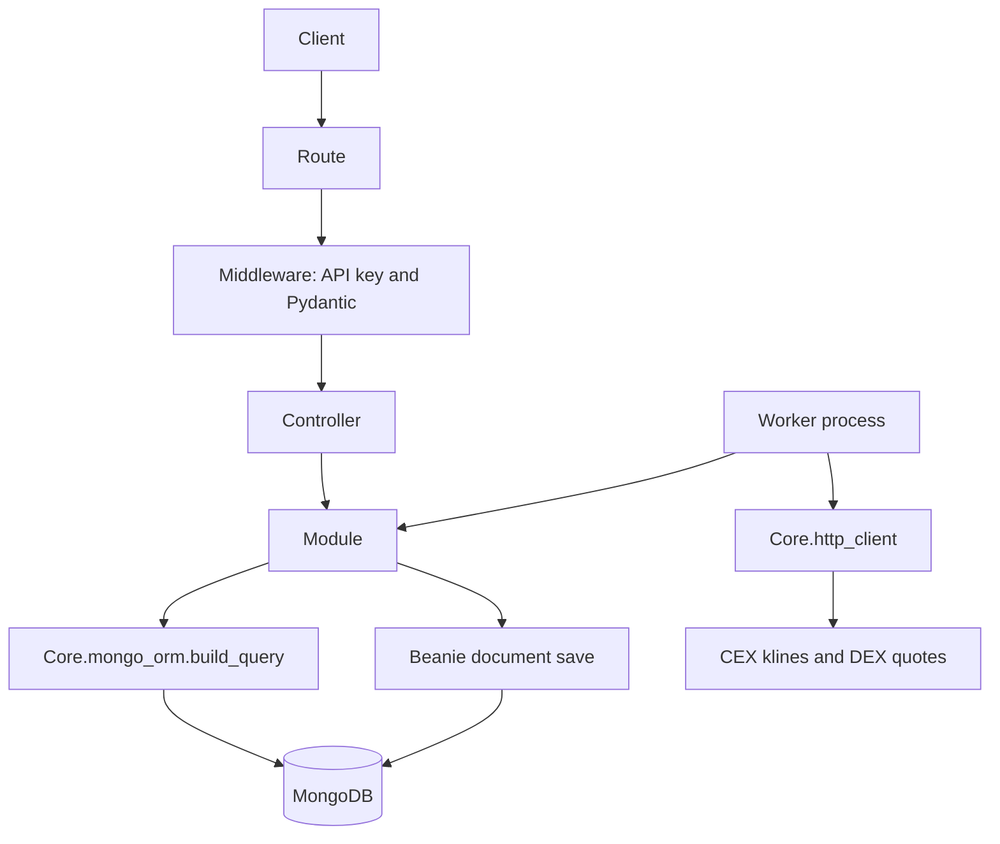
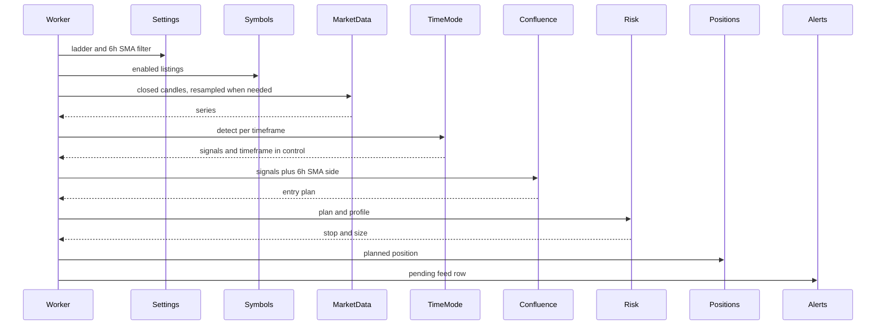

# Architecture

crypto-signals-with-grok-bot scans crypto markets with Miguel's time@mode rules, plans a stop and a size, and leaves an alert the Grok Bot can poll. This document is the planning architecture. Detection rules are in [strategy-spec.md](strategy-spec.md). Every domain's files and fields are in [repositories.md](repositories.md). Most files in this pass are placeholders.

## Stack

| Concern | Choice | Why |
| --- | --- | --- |
| Language | Python 3.12 | The working scanner is Python, and the whole app stays in one language. |
| API | FastAPI | Async, first-party Pydantic validation, and `APIRouter` maps onto verifik-backend's per-domain route files. |
| Validation | Pydantic v2 | Same role as the Joi checks in verifik middleware. |
| Mongo driver | Motor 3.x | Official async driver. Fits FastAPI and the worker without blocking the event loop. |
| Documents | Beanie 2 (on Motor) | Closest thing to Mongoose: document classes, field types, indexes, and timestamps, defined with Pydantic. PyMongo alone would be untyped dicts. Motor alone is the same, only async. |
| Reads | `Core.mongo_orm.build_query` | Same rule as verifik: modules do not invent their own queries. Beanie's `find` API is not the read path. |
| HTTP client | httpx, behind `Core.http_client` | Async, and one place to add timeouts and retries when the exchange fetch is ported. |
| Worker schedule | APScheduler, inside the worker process | One interval job. Celery and Redis are not justified until there is a real queue of work. Not a dependency in this pass. |
| Alerts | A `Notifier` protocol. The Grok Bot polls a feed | Webhook and email are the same protocol, later. The scan does not know about HTTP. |

PyMongo is the library Motor wraps. Application code does not construct a synchronous `MongoClient`.

Beanie is the model layer only. A module that needs documents calls `Core.mongo_orm.build_query(params, Signal, allowed_populates)` for reads, and calls `save()` on a Beanie document for inserts and updates. That split is the same one verifik uses: mongoose models for shape and writes, `mongo-orm.buildQuery` for reads.

## How this maps onto verifik-backend

verifik-backend (Koa, Mongoose) groups each domain under `Repositories/<Domain>/` and shares infrastructure in `Core/`. Their rule is: use the existing repository pattern, use Core to avoid duplication, send every read through `mongo-orm`, and call modules from controllers rather than from other modules. This repo keeps that rule. The example they sent (`APIRequestFilter` plus `Core/mongo-orm.js`) is the template for a domain.

| verifik-backend | this repo |
| --- | --- |
| `server.get(path, Middleware.getValidation, Controller.get)` | `APIRouter` route with `Depends(middleware model)` then a controller function |
| Joi (or empty) middleware | Pydantic model in `middlewares/` |
| `*.controller.js` try/catch and response shape | `*_controller.py` plus the shared error handler in `Core.errors` |
| `*.module.js` business logic | `*_module.py` |
| Mongoose schema in `*.model.js` | Beanie `Document` in `*_model.py` |
| `MongoORM.buildQuery(params, Model, null, allowedPopulates)` | `Core.mongo_orm.build_query(params, model, allowed_populates)` |
| `HttpHandler.errorHandler` → `{message, code}` | `AppError` → `{message, code}` |
| `Core/config.js` | `Core/config.py` (pydantic-settings) |
| `Core/database.js` | `Core/database.py` (Motor client; Beanie init receives the model list) |
| `Core/axios.js` | `Core/http_client.py` |
| `Core/cache.js` | `Core/cache.py` |
| `ctx.state.user` and `authUser.clientId` | Not ported. One shared API key. See below. |
| Kebab-case filenames (`api-request-filter.module.js`) | Snake-case filenames (`signal_module.py`), because Python modules cannot use hyphens |

Domain folders stay PascalCase (`Repositories/Signals`), matching verifik.

### What we are not copying

verifik is multi-tenant: almost every read adds `where_client` from `authUser.clientId`. This app does not copy that filter. It does have a `users` collection, because risk profiles and alerts are per user. Auth is still one `X-API-Key` (`Core/auth.py`), and that key maps to the seeded user. When `APP_ENV=development` and `API_KEY` is empty, the check is skipped. Staging and production must set `API_KEY`; a protected route returns 500 `server_misconfigured` if they do not.

## Layers



The worker is a second composition root. It is allowed to call modules the same way a controller is. A module must not import another domain's module.

Planned scan, once phase 1 fills the stubs in:



`Strategies/TimeMode` is a pure function of candles and params. Confluence scores a bundle it is given. Risk sizes a plan it is given. None of them fetch or call each other. The worker passes the data. The full file list is [repositories.md](repositories.md).

## Request flow

Same responsibilities as `api-request-filter.route.js` → middleware → controller → module → model.

1. **Route** (`routes/`). Declares the method, path, and which middleware dependency runs. No logic.
2. **Middleware** (`middlewares/`). Auth dependency plus a Pydantic model for query or body. Rejects a bad request before the controller. This replaces Koa's middleware chain.
3. **Controller** (`controllers/`). Calls one or more modules. Shapes the HTTP body. Does not catch errors locally; `AppError` and unexpected exceptions are handled in `Core.errors`.
4. **Module** (`modules/`). Business logic. Reads only through `build_query`. Writes with the domain model. Raises `AppError` for expected failures (`404` / `not_found`, `409` / `conflict`).
5. **Model** (`models/`). Beanie document: fields, types, indexes, collection name. No request objects.

List responses use the verifik envelope, built by `Core.http.list_response`:

```json
{"data": [], "total": 0, "limit": 20, "page": 1, "pages": 0}
```

Single-document responses are `{"data": ...}`. Updates and deletes add `"status": "completed"`. Domain errors are `{"message": "...", "code": "..."}` with the HTTP status on the response. Request-validation failures stay FastAPI's 422 `detail` list, because that payload is produced by Pydantic before the controller. Unhandled exceptions are logged and returned as 500 `internal_error` with a fixed message; the exception text is not sent to the client.

### Public filters vs the query builder

verifik often forwards the raw query string into `buildQuery`, so callers pass `where_symbol` and `in_type` themselves. This API does not. Public query params are explicit (`symbol`, `timeframe`, `page`, `limit`, `sort`) and validated by Pydantic. The module translates those into the `build_query` vocabulary. Two reasons: the public contract stays documented and stable, and the query builder is not an injection surface on the URL.

`build_query` still accepts verifik's parameter names, so module code can look like their modules. Planned keys:

| Param | Meaning |
| --- | --- |
| `where_<field>` | equality |
| `wherenot_<field>` | `$ne` |
| `where>_<field>`, `where>=_<field>`, `whereGTE_<field>` | `$gt`, `$gte` |
| `where<_<field>`, `where<=_<field>`, `whereLTE_<field>` | `$lt`, `$lte` |
| `in_<field>`, `notIn_<field>` | `$in`, `$nin` |
| `like_<field>`, `notLike_<field>` | substring match, case-insensitive |
| `prefix_<field>` | anchored prefix match |
| `where-null_<field>`, `where-not-null_<field>` | null / present |
| `where-exists_<field>` | `$exists` |
| `where-case-insensitive_<field>` | full-string match, case-insensitive |
| `findOne` | one document |
| `page`, `limit` or `perPage`, `offset`, `skipTotal` | page envelope; default limit 20 |
| `sort` or `sortBy` + `sortOrder` | `-field` is descending, as in mongoose |
| `select` or `columns` | projection |
| `populates` | relation load, only names in the module's allow-list |
| `count`, `sum` | aggregate reads |
| `lean` | plain dicts |

Date-only `YYYY-MM-DD` on `$lte` / `$lt` should cover the UTC day, matching verifik. Field names are restricted to letters, digits, underscore, and dot. `like_`, `notLike_`, and `prefix_` must escape regex metacharacters (verifik escapes `prefix_` only; we escape all three on purpose). `__match` from their parser is not part of our public or module API; it would let a caller inject raw operators.

`build_query` raises `NotImplementedError` in this pass. The list routes return an empty page without touching Mongo, so the process starts with no database. Phase 1 replaces those module bodies with real `build_query` calls. Modules must not grow a private `collection.find` in the meantime.

Populates are allow-listed per call (`allowed_populates`). A requested relation that is not on the list is ignored. There are no relations in v1 worth populating; signal payloads embed their details.

## Processes

Two processes, one codebase:

- **API** — `uvicorn app.main:app`. Serves `/health`, `/docs`, and `/api/v1`. Does not scan on a timer. A later `POST /api/v1/scanner/runs` may enqueue one scan; the worker executes scans.
- **Worker** — `python -m app.worker`. Loads settings and enabled symbols, fetches or resamples closed candles, runs time@mode, scores confluence, sizes a position, and inserts a pending alert for the Grok Bot. The schedule (default 900 seconds, `SCAN_INTERVAL_SECONDS`) lives here, via APScheduler once the scanner port adds it. The skeleton's `--once` flag logs that the scanner is not ported and exits 0.

The API does not open Mongo in this pass. `Core.database.connect(models)` is the phase 1 startup call. The model list is `app/documents.py`, not a hard-coded import inside Core, so Core does not depend on every domain. The list includes the planned documents (risk, positions, arbitrage, symbols, settings) so the schema is one place. `connect()` is still not called.

Dedup moves off `prototype/state.json`. The signal's deterministic `signal_id` has a unique index. A repeated scan upserts the same document and does not insert a second alert. Alert uniqueness is `(subject_type, subject_id, channel_kind)`.

## Domains

The per-domain files, endpoints, fields, and indexes are in [repositories.md](repositories.md). Summary:

| Domain | Responsibility | Collections |
| --- | --- | --- |
| `Users` | Accounts and roles | `users` |
| `Auth` | Signup flag, JWT, user API keys | `api_keys`, `refresh_tokens` |
| `Billing` | Plans, Stripe-synced entitlements, BTCPay and NOWPayments | `plans`, `entitlements`, `subscriptions`, `payment_events` |
| `Publications` | Per-tier `release_at` fan-out | `publications` |
| `Webhooks` | Signed outbound deliveries to the user's bot | `webhook_endpoints`, `webhook_deliveries` |
| `Compliance` | Consents, disclosures, Canada futures gate. Not legal advice | `consents`, `disclosures`, `geo_rules` |
| `Performance` | Append-only log and outcomes | `signal_logs`, `outcomes` |
| `PaperTrading` | House and personal simulation | `paper_accounts`, `paper_fills` |
| `ExchangeAccounts` | Later, encrypted trade-only keys | `exchange_accounts` |
| `Audit` | Append-only security and billing trail | `audit_logs` |
| `Symbols` | All pairs to monitor, any quote, per venue | `symbols` |
| `Settings` | Ladder, scanner, symbol prefs, arbitrage settings | `app_settings` |
| `Exchanges` | CEX klines, native intervals, symbol style, fees | `exchange_sources` |
| `Dexes` | DEX quotes and gas inputs | `dex_venues` |
| `MarketData` | Closed candles and resampling | `candles` |
| `Strategies/TimeMode` | Mode and block detection, timeframe in control | `strategy_configs` |
| `Strategies/Confluence` | Score and one entry plan | `confluence_configs`, `entry_plans` |
| `Signals` | Detector rows and scan runs | `signals`, `scan_runs` |
| `Watchlists` | Optional subsets of `symbols` | `watchlists` |
| `Risk` | Stops, size, leverage, targets | `risk_profiles` |
| `Positions` | Planned trades and lifecycle events | `positions`, `position_events` |
| `Alerts` | Grok Bot feed; webhook and email later | `alerts`, `alert_channels` |
| `Backtests` | Historical runs, including sizing | `backtests`, `backtest_events` |
| `Arbitrage` | Cross-venue net spreads. No orders | `arbitrage_opportunities`, `venue_quotes` |

There is no `Scanner` domain and no separate futures domain. Futures is a `market` value. `GET /api/v1/scanner/status` stays on the app router.

## Alert delivery

Generation and publication are separate. The worker appends `signal_logs` at the triggering candle close. `Publications` fans that row out with `release_at = created_at + signals.delay_seconds`, and every read filters on `release_at`. Alerts and signed webhooks are created from publications, not from the raw signal. Until that phase exists, the Grok Bot feed is the owner view.

The first channel is `grok_chat`. The bot polls `GET /api/v1/alerts/feed` and posts `delivered` or `acked`. `GrokChatNotifier` does not push. Webhook, email, Telegram, and Discord are later kinds. A plan's `channels` list is what a subscriber may enable.

Product rules, the legal gate, and the four launch stages are in [saas.md](saas.md).

## Configuration and prototype bridge

Process settings (port, Mongo URL, API key, log level) come from the environment. Strategy parameters, the ladder, risk, confluence weights, and the symbol universe are Mongo documents. `Core/planning_seeds.py` holds Miguel's resolved defaults until phase 2 inserts them.

`Core.prototype_config` still reads `prototype/config.json` for the detection params he has not replaced (ATR length, mode windows, and the rest). The time@mode show route overlays `sma_filter_timeframe: "6h"` and does not return the old `ltf_map` as the live ladder. The prototype file is not edited. Phase 2 deletes the runtime read once `strategy_configs` is seeded.

## Failure behavior (planned)

- A single symbol/timeframe fetch failure is recorded on the scan run and the scan continues with the next source, then the next pair. This matches `prototype/data.py`.
- If every fetch fails, the scan run is `failed` and no signals are deleted.
- An alert failure marks that alert `failed`, increments `attempts`, and does not fail the scan.
- The API stays up if Mongo is down: health reports `mongo: "not_connected"` in this pass, and phase 1 should make `/health` report a live ping without taking the process down on a failed ping. Read routes then return 503 `mongo_unavailable`.

## Security notes for the implementer

- Public kline endpoints need no exchange API keys. Do not add key storage until a private endpoint exists.
- `build_query` must not accept raw operator documents from the outside.
- The API key is compared as a string. Phase 1 can switch to `hmac.compare_digest` without a contract change.
- CORS is off until a browser UI exists. The UI is a later client, not a domain in this repo.
