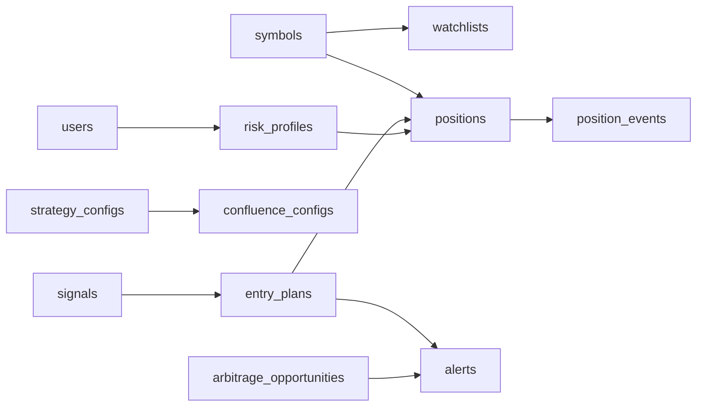

# Domain and data model

MongoDB is the only database. Database name: `MONGODB_DB` (default `crypto_signals`). Collection names are snake_case plurals, set on the Beanie document (`Settings.name`), not inferred from the class name.

The prototype keeps dedup state in `state.json`. That file goes away. A signal is stored once, keyed by the same deterministic id the scanner already computes. Seeing a signal and storing a signal are the same write.

Beanie documents for the active collections are declared under each domain's `models/` and listed in `app/documents.py`. `Position` and `ArbitrageOpportunity` exist as reserved models and are not in that list, so `init_beanie` will not create those collections until their phase.

Every active collection has `created_at` and `updated_at` (UTC). The API exposes Mongo `_id` as string `id` and does not return `_id`.

Floats match the prototype (IEEE). That is enough for signal levels. It is not an accounting type. Position size, if it arrives with futures, should be reconsidered before money is calculated.

## How configuration is stored

Mongo holds the live settings. `prototype/config.json` is the detection oracle for rules Miguel has not replaced. It is not the ladder and it is not the symbol universe.

| Concern | Collection |
| --- | --- |
| Mode and block parameters | `strategy_configs.params` (`sma_filter_timeframe` is `6h`) |
| Ladder, 6h SMA length, decision and entry timeframes | `app_settings` key `ladder` |
| History window, report window, source order | `app_settings` key `scanner` and `strategy_configs.scanner` |
| Pairs to monitor | `symbols` |
| Stops, size, targets, exit rule | `risk_profiles` |
| Confluence weights | `confluence_configs` |
| Optional named subsets | `watchlists` (symbol ids only, no `ltf_map`) |

The old `ltf_map` (`1w→1d→6h→1h→15m`) is not stored. Field-level tables for the new collections are in [repositories.md](repositories.md). The sections below keep the detector collections and note what changed on the older ones.

## `signals`

One detected event. Unique on `signal_id`.

| Field | Type | Notes |
| --- | --- | --- |
| `signal_id` | string | First 16 hex chars of SHA-1. See below. Unique. |
| `type` | string | `mode_confirmed`, `bias_flip`, `mode_expiry`, `block_breakout_entry`, `exit` |
| `symbol` | string | Exchange symbol, e.g. `BTCUSDT`, `ETHBTC` |
| `timeframe` | string | `15m`, `30m`, `1h`, `4h`, `6h`, `1d`, `1w` |
| `direction` | string | `bullish` or `bearish` for mode signals; `long` or `short` for block entries and exits. Preserved from the prototype. |
| `close_time` | datetime | UTC close of the signal candle |
| `close_time_edmonton` | string | ISO string in `America/Edmonton`, matching the prototype's display field |
| `price` | float | Close of the signal candle |
| `level` | float | Mode price or block price |
| `level_kind` | string | `mode` or `block` |
| `atr` | float | ATR(14) RMA of the previous candle |
| `atr_distance` | float | Signed so positive means "in the signal's direction" |
| `tradingview_url` | string | `https://www.tradingview.com/chart/?symbol=BINANCE:{symbol}&interval={tv}` |
| `details` | object | Type-specific extras. Keys below. |
| `strategy_key` | string | `time_mode` |
| `market` | string | `spot` for now. `futures` later. |
| `status` | string | `new`, `acknowledged`, `dismissed` |
| `scan_run_id` | object id or null | The run that first inserted it |

Indexes:

- unique `signal_id`
- `(symbol, timeframe, close_time)`
- `(type, close_time)`
- `(status, close_time)`

`signal_id` input, from `prototype/scan.py`:

```text
sha1(f"{type}|{symbol}|{timeframe}|{direction}|{close_time_ms}|{htf}|{level:.10g}")[:16]
```

`htf` is empty for mode signals. `close_time_ms` is the candle close timestamp in milliseconds. The format of `level` must stay `.10g` or ids will not match the prototype.

### `details` by type

`mode_confirmed`:

- `mode_length`, `mode_anchor` (`HL` wick low, `LH` wick high)
- `mode_anchor_time_utc`, `mode_start_time_utc`
- `confirmations` (list: `atr_expansion`, `close_outside_range`, `clear_gap`)
- `body_crosses_mode`
- `projected_expiry_close_utc`, `projected_expiry_close_edmonton`
- `trend`

`bias_flip` and `mode_expiry`:

- `mode_length`, `mode_confirmed_close_utc`, `trend`
- `mode_expiry` also has `expiry_bar_made_new_extreme`

`block_breakout_entry` and `exit`:

- `htf`, `htf_block_close_utc`
- `sma`, `expansion_candle` on entries
- `entry_close_utc` on exits

The API may flatten `details` next to the common fields when returning a signal, so a client sees the same JSON the prototype prints. The stored shape stays nested so a new signal type does not add a pile of null columns.

## `scan_runs`

Owned by the Signals domain. One document per worker pass or manual run.

| Field | Type | Notes |
| --- | --- | --- |
| `started_at`, `finished_at` | datetime | `finished_at` null while running |
| `status` | string | `running`, `completed`, `failed` |
| `sources` | object | Counts by source name, e.g. `{"binance": 20}` |
| `errors` | string array | Per-request failures. A partial scan can still be `completed`. |
| `symbols`, `timeframes` | string arrays | What this run covered |
| `signals_found` | int | Detector output inside the report window |
| `signals_new` | int | Inserts that did not already exist |
| `strategy_key` | string | |
| `strategy_version` | int or null | |

Index: `(started_at)` descending. Retention is a later job; 90 days is the proposed default (open question).

## `strategy_configs`

Versioned parameter documents. The active one is `active: true` for a given `key`. Seeding inserts version 1 from `prototype/config.json` if the collection is empty. Editing creates the next version and flips `active`, so a backtest can keep the snapshot it ran with.

| Field | Type | Notes |
| --- | --- | --- |
| `key` | string | `time_mode` |
| `version` | int | Starts at 1 |
| `active` | bool | One active document per key |
| `params` | object | The `params` object from the prototype config. See the strategy spec. |
| `scanner` | object | `history_bars` (1000), `report_window_bars` (3), `data_sources`, `state_retention_days` (120). No `ltf_map` |
| `notes` | string | |

Unique index: `(key, version)`.

`params` keys and the prototype defaults:

| Key | Default |
| --- | --- |
| `atr_length` | 14 |
| `confirm_atr_mult` | 0.7 |
| `sma_length` | 70 |
| `mode_min_bars` | 5 |
| `mode_max_bars` | 20 |
| `swing_lookback` | 5 |
| `consolidation_limit` | 20 |
| `body_range_ratio` | 0.6 |
| `mode_touch_density` | 0.75 |
| `mode_touch_tol_atr` | 0.02 |
| `expansion_rule` | `either` |
| `confirm_types` | `atr_expansion`, `close_outside_range`, `clear_gap` |
| `body_cross_count_rule` | `{"default": "confirm_bar", "1w": "part_of_mode_next_bar"}` |
| `flip_window_bars` | 3 |
| `flip_requires_engulfing` | true |
| `flip_requires_expansion` | true |
| `expiry_after_flip` | false |
| `block_min_bars_after` | 2 |
| `sma_filter_timeframe` | `6h` |
| `exit_rule` | `two_lower_closes` |
| `enable_shorts` | true |
| `block_ttl_bars` | 30 |
| `block_merge_atr` | 0.25 |

A value may be a per-timeframe object `{"default": ..., "1w": ...}`. `params_for` in the prototype resolves that. The port keeps the same resolution.

`sma_filter_timeframe` inside `params` is `6h` on every new version. The ladder itself is `app_settings` key `ladder`: `4h`, `6h`, `8h`, `1d`, `3d`, `1w`, `1M`.

Default `scanner.data_sources`, in order: `binance`, `binance_vision`, `bybit`, `okx`. Coinbase and Kraken are catalog rows with `enabled: false` until their connectors exist.

## `watchlists`

Optional subsets of `symbols`. The scanner's default set is enabled symbol rows, with USDT preferred via settings, not via this collection.

| Field | Type | Notes |
| --- | --- | --- |
| `name` | string | |
| `symbol_ids` | object id array | Rows in `symbols` |
| `strategy_key` | string | `time_mode` |
| `enabled` | bool | |

Index: `(enabled)`. There is no `ltf_map` and no embedded timeframe list. The ladder is global.

## `candles`

Optional cache. Exchanges are the source of truth. Phase 1 may scan without writing candles, the way the prototype does. Backtests are the reason to fill this collection.

| Field | Type | Notes |
| --- | --- | --- |
| `exchange`, `symbol`, `timeframe` | string | |
| `open_time`, `close_time` | datetime UTC | |
| `open`, `high`, `low`, `close`, `volume` | float | |
| `origin` | string | `native` or `resampled` |
| `source_timeframe` | string or null | Set when `origin` is `resampled` |

Unique index: `(exchange, symbol, timeframe, open_time)`.

Only closed candles are stored. The still-forming candle is dropped before insert. Retention: keep `history_bars` per series, or a TTL later. Not specified as a hard rule yet.

## `exchange_sources`

The fallback chain. Seeded from the prototype order. Public klines, `auth: "none"`.

| Field | Type | Notes |
| --- | --- | --- |
| `name` | string | `binance`, `binance_vision`, `bybit`, `okx`, `coinbase`, `kraken`. Unique. |
| `priority` | int | Lower runs first |
| `kind` | string | `spot_klines` |
| `base_url` | string | |
| `market` | string | `spot` |
| `enabled` | bool | |
| `auth` | string | `none` or, later, `api_key` |
| `symbol_style` | string | `concat`, `dash`, or `alias`. OKX is `dash` (`BTC-USDT`, `ETH-BTC`), never `symbol[:-4] + "-USDT"` |
| `native_timeframes` | string array | Ladder bars the venue actually serves |
| `resample_from` | object | Target timeframe → source timeframe when not native |
| `maker_fee_bps`, `taker_fee_bps` | number or null | Used by arbitrage |
| `withdrawal_fees` | object | Asset → quote amount |

The venue table (Binance has 8h, 3d, and 1M; Bybit lacks 8h and 3d; OKX lacks 8h; Coinbase and Kraken lack several) is in [repositories.md](repositories.md).

Known base URLs from `prototype/data.py`, plus the planned venues:

| name | base_url |
| --- | --- |
| `binance` | `https://api.binance.com` |
| `binance_vision` | `https://data-api.binance.vision` |
| `bybit` | `https://api.bybit.com` |
| `okx` | `https://www.okx.com` |
| `coinbase` | `https://api.exchange.coinbase.com` |
| `kraken` | `https://api.kraken.com` |

## `alert_channels`

| Field | Type | Notes |
| --- | --- | --- |
| `name` | string | |
| `kind` | string | `grok_chat` first. `webhook` and `email` later. |
| `config` | object | Empty for `grok_chat`. Webhook: `url`, optional `headers`. Email: `to`. Secrets. |
| `enabled` | bool | |

## `alerts`

One delivery attempt-group per signal per channel.

| Field | Type | Notes |
| --- | --- | --- |
| `channel_id` | object id or null | |
| `channel_kind` | string | Denormalized so the feed does not need a join |
| `subject_type` | string | `signal`, `entry_plan`, `position`, `arbitrage_opportunity` |
| `subject_id` | string | |
| `status` | string | `pending`, `delivered`, `acked`, `failed` |
| `attempts` | int | |
| `last_error` | string or null | |
| `payload` | object | What the bot renders |
| `delivered_at`, `acked_at` | datetime or null | |

Unique index: `(subject_type, subject_id, channel_kind)`. Feed index: `(channel_kind, status, created_at)`.

## `backtests` and `backtest_events`

A backtest is a historical run of the same pure detector, not a second strategy. Events are a separate collection so a long run does not hit Mongo's 16 MB document limit.

`backtests`:

| Field | Type |
| --- | --- |
| `name` | string |
| `strategy_key`, `strategy_version` | string, int or null |
| `params_snapshot` | object |
| `symbols`, `timeframes` | string arrays |
| `start`, `end` | datetime |
| `status` | `queued`, `running`, `completed`, `failed` |
| `summary` | object (counts by type, and later trade stats) |
| `error` | string or null |
| `finished_at` | datetime or null |

`backtest_events`:

| Field | Type |
| --- | --- |
| `backtest_id` | object id |
| `signal_id`, `type`, `symbol`, `timeframe`, `direction` | string |
| `close_time` | datetime |
| `payload` | object |

Index: `(backtest_id, close_time)`.

The summary does not include PnL until stop and size rules exist. Until then a backtest reports signal counts and the chart-replay score, not money.

## Collections added with Miguel's answers

Full fields and indexes are in [repositories.md](repositories.md). Names:

| Collection | Domain |
| --- | --- |
| `users` | Users |
| `symbols` | Symbols |
| `app_settings` | Settings |
| `dex_venues` | Dexes |
| `confluence_configs`, `entry_plans` | Strategies/Confluence |
| `risk_profiles` | Risk |
| `positions`, `position_events` | Positions |
| `arbitrage_opportunities`, `venue_quotes` | Arbitrage |
| `api_keys`, `refresh_tokens` | Auth |
| `plans`, `subscriptions`, `payment_events` | Billing |
| `publications` | Publications |
| `signal_logs`, `outcomes` | Performance |
| `paper_accounts`, `paper_fills` | PaperTrading |
| `exchange_accounts` | ExchangeAccounts |
| `audit_logs` | Audit |

Tenancy, delays, the hash chain, and the legal gate are specified in [saas.md](saas.md). Field lists for these collections are in [repositories.md](repositories.md).

`positions` cover spot and futures. There is no separate futures collection. `size_base` is null when the risk profile has no equity yet. Arbitrage rows store net spread and do not store an order id.

## Relationships



The worker loads settings, symbols, and strategy config, then passes candles into detection and the resulting bundle into confluence, risk, positions, and alerts. A module does not load another domain's documents.
