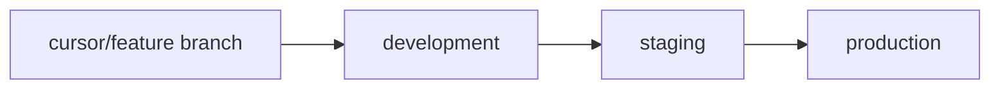

# Environments and branching

Three long-lived branches were created from `main` at the initial commit. Feature work does not land on them directly.



| Branch | Tracks | What runs there |
| --- | --- | --- |
| `main` | Repository default. Source of the three branches. No ongoing app work. | Nothing deployed from here by this plan. |
| `development` | Integration. Feature PRs target this branch. | Local machines, and a dev deployment if one exists. |
| `staging` | Promotion from `development`. | Staging API, staging worker, staging database. |
| `production` | Promotion from `staging`. | Production API, production worker, production database. |

Promotion is a pull request: `development` → `staging`, then `staging` → `production`. No direct commits. Hotfixes branch off `production`, PR back into `production`, then back-merge into `staging` and `development` so the fix is not lost.

`main` stays at the initial snapshot until someone decides it should mirror `production`. This plan does not change GitHub's default branch. If `development` should become the default so new clones see the app, that is a one-time repository setting Miguel can flip after this PR merges.

## Config

The same code runs in every environment. The environment variables in `.env.example` are the whole switch. There is no separate settings file per branch.

| Variable | development | staging | production |
| --- | --- | --- | --- |
| `APP_ENV` | `development` | `staging` | `production` |
| `API_KEY` | optional | required | required |
| `LOG_LEVEL` | `DEBUG` or `INFO` | `INFO` | `INFO` |
| `MONGODB_URL` | local Mongo | staging cluster | production cluster |
| `MONGODB_DB` | `crypto_signals` | `crypto_signals` | `crypto_signals` |
| `SCAN_INTERVAL_SECONDS` | `900` (or shorter while testing) | `900` | `900` |

Each environment has its own database. Do not point staging at the production URL. The API key is a different secret in each environment. Exchange market-data calls in v1 use public klines and need no key; if a private key is added later it is an environment secret, not a row in git.

`APP_ENV=development` with an empty `API_KEY` leaves `/api/v1` open. That combination is not valid for staging or production: protected routes fail closed with `server_misconfigured`.

## Processes

Each deployed environment runs:

1. API: `uvicorn app.main:app --host 0.0.0.0 --port 8000`
2. Worker: `python -m app.worker`
3. MongoDB 7.x

The API and the worker share `MONGODB_URL` and the code version of that environment. They do not share a process. Restarting the API must not skip a scan, and a scan must not block requests.

No Dockerfile and no cloud account are part of this pass. The layout above is what a container or a process manager should wrap. Where it is hosted (a VM, a container platform) is open.

## Local setup

```bash
python3 -m venv .venv
source .venv/bin/activate
pip install -e ".[dev,scanner]"
cp .env.example .env
```

Mongo is not required for the skeleton. When you want it:

```bash
# any local Mongo 7.x on port 27017
# example: docker run -d --name crypto-signals-mongo -p 27017:27017 mongo:7
```

Create the three remote branches only if they are missing. They already exist after the planning PR's setup:

```bash
git push origin main:development
git push origin main:staging
git push origin main:production
```

Day to day:

```bash
git checkout development
git pull origin development
git checkout -b cursor/<short-name>-9f8f
# ... work, commit ...
git push -u origin cursor/<short-name>-9f8f
# open the PR with base development
```

Branch names for this agent use the `cursor/` prefix and the `-9f8f` suffix. People working outside that agent can use the same prefix or a plain `feature/` name; the rule that matters is the PR base, not the prefix.

## Secrets

- `.env` is gitignored. `.env.example` holds empty placeholders.
- Do not put webhook URLs, API keys, or Mongo passwords in docs, fixtures, or `prototype/config.json`.
- The prototype scanner needs no exchange credentials.

## CI

`.github/workflows/test.yml` runs ruff and pytest on pushes and pull requests. It does not need Mongo or exchange network access. Tests that will need Mongo in phase 2 should be marked so this workflow stays green without a service container until that service is added on purpose.
