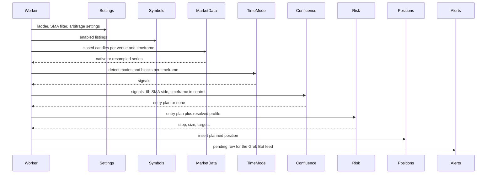

# Repositories

Every domain lives in `Repositories/<Domain>/` and follows the same shape as verifik-backend: `routes/` → `middlewares/` → `controllers/` → `modules/` → `models/`, plus `helpers/` and `tests/`. Shared code stays in `Core/`. Modules do not import other domains' modules. The worker and the controllers are the composition roots.

File names are `snake_case` with a role suffix. Folders are PascalCase. Reads go through `Core.mongo_orm.build_query`. Writes go through the Beanie document. This pass adds the files and the schema. The functions return placeholders and do not scan, size a live account, or send an order.

Runtime numbers Miguel has already decided (the ladder, the 6h SMA, confluence weights, the risk seed, the venue catalog) live in `Core/planning_seeds.py` until phase 2 copies them into Mongo. After that, Mongo is the source and the seed file is only the initial insert.

| Domain | Collections | What it owns |
| --- | --- | --- |
| `Users` | `users` | Accounts and roles (`owner`, `admin`, `subscriber`, `free`) |
| `Auth` | `api_keys`, `refresh_tokens` | Signup flag, JWT, API keys |
| `Billing` | `plans`, `subscriptions`, `payment_events` | Tiers, entitlements, Stripe, crypto later |
| `Publications` | `publications` | Per-subscriber release of a signal, with delay |
| `Performance` | `signal_logs`, `outcomes` | Append-only log and measured results |
| `PaperTrading` | `paper_accounts`, `paper_fills` | Simulated track record |
| `ExchangeAccounts` | `exchange_accounts` | Later, encrypted trade-only keys |
| `Audit` | `audit_logs` | Security and billing audit trail |
| `Symbols` | `symbols` | Every pair to monitor, any quote, per venue |
| `Settings` | `app_settings` | Ladder, scanner, arbitrage settings |
| `Exchanges` | `exchange_sources` | CEX connectors, native intervals, symbol style |
| `Dexes` | `dex_venues` | DEX connectors and gas inputs |
| `MarketData` | `candles` | Closed candles, including resampled bars |
| `Strategies/TimeMode` | `strategy_configs` | Mode and block detection parameters |
| `Strategies/Confluence` | `confluence_configs`, `entry_plans` | Multi-timeframe score and the entry decision |
| `Signals` | `signals`, `scan_runs` | Raw detector output and scan bookkeeping |
| `Watchlists` | `watchlists` | Optional named subsets of `symbols` |
| `Risk` | `risk_profiles` | Stops, size, leverage, targets, exit rule |
| `Positions` | `positions`, `position_events` | Planned trades and their lifecycle |
| `Alerts` | `alert_channels`, `alerts` | Grok Bot feed now; webhook and email later |
| `Backtests` | `backtests`, `backtest_events` | Historical runs of the same functions |
| `Arbitrage` | `arbitrage_opportunities`, `venue_quotes` | Cross-venue spreads, net of costs. No orders |

There is no `Futures` domain and no `Scanner` domain. Futures is `market: "futures"` on a symbol, a position, and an exchange source. The worker is the scanner.

## Worker composition



Arbitrage is a second pass in the same worker tick: Exchanges and Dexes return quotes, the worker passes them into the Arbitrage module, and a new opportunity becomes another alert row. No leg is sent to a venue.

## Users

Accounts. Login and keys are the Auth domain. Product rules are in [saas.md](saas.md).

| File | Responsibility |
| --- | --- |
| `routes/user_route.py` | `GET /api/v1/users`, `GET /api/v1/users/me`, `GET /api/v1/users/{id}`, `PATCH /api/v1/users/{id}` |
| `middlewares/user_middleware.py` | Patch body: `name`, `status`. Role changes are owner-only and audited |
| `controllers/user_controller.py` | List and profile |
| `modules/user_module.py` | CRUD through `build_query`. Does not issue tokens |
| `models/user_model.py` | `User` |

`users`: `email` (unique, sparse), `name`, `password_hash` (null until signup exists; never returned), `role` (`owner`, `admin`, `subscriber`, `free`), `status` (`active`, `disabled`), `email_verified`, `created_at`, `updated_at`. Indexes: unique sparse `email`, `(role, status)`.

The first seeded account is `role: owner`. Public signup creates `free`. `subscriber` is set by Billing when a subscription is `trialing` or `active`, and returns to `free` when it ends. Staff roles are not for sale.

Skeleton: `GET /api/v1/users` is an empty page. No person is invented.

## Symbols

The universe of pairs. USDT is the preferred quote (`PREFERRED_QUOTE_ASSETS` in the seed, stored on `app_settings` key `symbols`). Any other quote is allowed. The four majors in `prototype/config.json` are not the list.

| File | Responsibility |
| --- | --- |
| `routes/symbol_route.py` | `GET/POST /api/v1/symbols`, `GET/PATCH/DELETE /api/v1/symbols/{id}` |
| `middlewares/symbol_middleware.py` | Filters: `quote_asset`, `base_asset`, `market`, `enabled`, `tag`, `venue`, `priority`. Body below |
| `controllers/symbol_controller.py` | List envelope and single `data` |
| `modules/symbol_module.py` | CRUD. Does not call exchanges. A later sync job is a worker call into this module with instrument rows the Exchanges module already fetched |
| `models/symbol_model.py` | `Symbol`, embedded `Listing` |

`symbols`:

| Field | Type | Notes |
| --- | --- | --- |
| `base_asset`, `quote_asset` | string | `BTC`, `USDT`. Any quote |
| `market` | string | `spot` or `futures` |
| `enabled` | bool | Scanner skips disabled rows |
| `tags` | string array | Free labels: `major`, `arbitrage`, and so on |
| `priority` | int | Lower numbers are scanned first |
| `listings` | array | One row per venue. See below |
| `created_at`, `updated_at` | datetime | |

`listings[]`: `venue_kind` (`cex` or `dex`), `venue` (`binance`, `bybit`, `okx`, `coinbase`, `kraken`, or a dex name), `venue_symbol`, `status` (`trading` or `halted`).

Indexes: unique `(base_asset, quote_asset, market)`; `(enabled, priority)`; `(listings.venue, listings.venue_symbol)`.

Symbol style is a property of the venue, not a string slice in the client:

| Style | Rule | Venues |
| --- | --- | --- |
| `concat` | `base + quote` → `BTCUSDT`, `ETHBTC` | Binance, Binance Vision, Bybit |
| `dash` | `base + "-" + quote` → `BTC-USDT`, `ETH-BTC` | OKX, Coinbase |
| `alias` | Only the stored `venue_symbol`. Never derived | Kraken (`XBT/USDT` is not `BTCUSDT`) |

The prototype's OKX line `symbol[:-4] + "-USDT"` is wrong for any non-USDT pair and is not ported. OKX bars that have a UTC variant (`6Hutc`, `1Dutc`, `3Dutc`, `1Wutc`, `1Mutc`) are the ones the connector requests, so opens line up with Binance.

Skeleton: `GET /api/v1/symbols` is an empty page. Loading the venue instrument lists is a later job.

## Settings

Mongo documents for everything that used to be a config file, except secrets (those stay in the environment).

| File | Responsibility |
| --- | --- |
| `routes/settings_route.py` | `GET/PUT /api/v1/settings/ladder`, `GET/PUT /api/v1/settings/scanner`, `GET/PUT /api/v1/settings/symbols`, `GET/PUT /api/v1/settings/arbitrage`, `GET/PUT /api/v1/settings/auth` |
| `middlewares/settings_middleware.py` | Body is the `value` object for that key. Unknown keys are 422 |
| `controllers/settings_controller.py` | One show/update pair per key |
| `modules/settings_module.py` | Versioned upsert. Show returns the seed with `persisted: false` until Mongo has a row |
| `models/app_setting_model.py` | `AppSetting` |

`app_settings`: `key` (`ladder`, `scanner`, `symbols`, `arbitrage`, `auth`), `version`, `active`, `value` (object), `created_at`, `updated_at`. Unique `(key, version)`.

`value` for `ladder` (the seed):

| Field | Seed |
| --- | --- |
| `timeframes` | `4h`, `6h`, `8h`, `1d`, `3d`, `1w`, `1M` from low to high |
| `sma_filter_timeframe` | `6h` |
| `sma_length` | `70` |
| `decision_timeframes` | `1w`, `3d`, `1d` |
| `entry_timeframes` | `4h`, `6h`, `8h` |
| `context_timeframe` | `1M` |
| `alignment` | `binance` |

`scanner.value`: `history_bars` 1000, `report_window_bars` 3, `state_retention_days` 120, `data_sources` the enabled CEX order. There is no `ltf_map`. The old `1w→1d→6h→1h→15m` map is retired.

`symbols.value`: `preferred_quote_assets: ["USDT"]`, `scan_enabled_only: true`.

`arbitrage.value`: see the Arbitrage section.

`auth.value`: `default_user_id` null until the user is seeded.

Skeleton: `GET /api/v1/settings/ladder` and `GET /api/v1/settings/scanner` return the seed.

## Exchanges

CEX connectors. Public klines need no API key. Read-only balance keys, when a risk profile uses `account.source = exchange_balance`, are a later secret and are not in git.

| File | Responsibility |
| --- | --- |
| `routes/exchange_route.py` | `GET /api/v1/exchanges`, `GET /api/v1/exchanges/{name}`, `PUT /api/v1/exchanges/{name}` (`enabled`, `priority`) |
| `middlewares/exchange_middleware.py` | Update body |
| `controllers/exchange_controller.py` | List and show |
| `modules/exchange_module.py` | Catalog reads. Fetch functions land here in the port: `fetch_klines(source, listing, timeframe, limit)` returns closed candles or raises. No resampling in this module |
| `models/exchange_source_model.py` | `ExchangeSource` |
| `helpers/` | Interval code maps (`1h` → Bybit `60`, OKX `1Hutc`). Pure |

`exchange_sources`: `name` (unique), `priority`, `kind` (`spot_klines` or `futures_klines`), `base_url`, `market`, `enabled`, `auth` (`none` or `api_key`), `symbol_style` (`concat`, `dash`, `alias`), `native_timeframes` (string array), `resample_from` (object, target → source timeframe), `maker_fee_bps`, `taker_fee_bps`, `withdrawal_fees` (object of asset → quote amount). Timestamps.

Native ladder coverage, from each venue's public kline docs:

| Venue | 4h | 6h | 8h | 1d | 3d | 1w | 1M | Enabled in the seed |
| --- | --- | --- | --- | --- | --- | --- | --- | --- |
| Binance and Binance Vision | yes | yes | yes | yes | yes | yes | yes | yes |
| Bybit v5 (`240`,`360`,`D`,`W`,`M`) | yes | yes | no | yes | no | yes | yes | yes |
| OKX v5 | yes (`4H`) | yes (`6Hutc`) | no | yes (`1Dutc`) | yes (`3Dutc`) | yes (`1Wutc`) | yes (`1Mutc`) | yes |
| Coinbase Exchange (granularity seconds) | no | yes (`21600`) | no | yes (`86400`) | no | no | no | no, until the connector exists |
| Kraken spot OHLC (minutes) | yes (`240`) | no | no | yes (`1440`) | no | yes (`10080`) | no | no, until the connector exists |

Bybit has no 8h and no 3d. OKX has no 8h. Coinbase has no 4h, 8h, 3d, 1w, or 1M. Kraken has no 6h, 8h, 3d, or 1M. Kraken's extra `21600` minute interval is 15 days, which is not 1M. Missing bars are resampled. A native bar is used only after a fixture check shows its open times match Binance for that timeframe. If OKX `3Dutc` or Coinbase `6h` does not match, the connector treats it as missing and resamples.

Skeleton: `GET /api/v1/exchanges` returns this catalog with `persisted: false` on each row.

## Dexes

DEX connectors for arbitrage quotes. They do not place swaps.

| File | Responsibility |
| --- | --- |
| `routes/dex_route.py` | `GET/POST /api/v1/dexes`, `GET/PATCH /api/v1/dexes/{name}` |
| `middlewares/dex_middleware.py` | Body: `name`, `chain`, `kind`, `quote_method`, `enabled` |
| `controllers/dex_controller.py` | List |
| `modules/dex_module.py` | CRUD, and later `quote(listing, side, size_quote) → {price, fee_bps, gas_quote}` |
| `models/dex_venue_model.py` | `DexVenue` |

`dex_venues`: `name` (unique), `kind` (`dex_pool` or `dex_aggregator`), `chain`, `protocol`, `quote_method` (`pool_mid` or `aggregator_quote`), `enabled`, `gas_units` (optional number), `taker_fee_bps`, `created_at`, `updated_at`.

Seed rows, both `enabled: false`: `uniswap_v3` on Ethereum (`pool_mid`), and `dex_aggregator` on Ethereum as a slot for an OKX onchain or 0x quote. Chains beyond Ethereum are more rows, not a code change.

Skeleton: `GET /api/v1/dexes` returns the seed.

## MarketData

Closed candles for the detector. Exchanges remain the source of truth. This collection is a cache.

| File | Responsibility |
| --- | --- |
| `routes/candle_route.py` | `GET /api/v1/market-data/candles` |
| `middlewares/candle_middleware.py` | Required `symbol` and `timeframe`. Optional `exchange`, `limit`, `end` |
| `controllers/candle_controller.py` | List envelope of candles |
| `modules/candle_module.py` | Read cache through `build_query`. `upsert_candles` for the worker |
| `modules/resample_module.py` | Pure: build a higher timeframe from a lower one. No HTTP |
| `models/candle_model.py` | `Candle` |

`candles`: `exchange`, `symbol` (the domain symbol id's venue symbol, stored as text), `timeframe`, `open_time`, `close_time`, `open`, `high`, `low`, `close`, `volume`, `origin` (`native` or `resampled`), `source_timeframe` (null when native). Unique `(exchange, symbol, timeframe, open_time)`.

Resample rules:

- Drop the still-forming source candle and the still-forming aggregate.
- Volume is the sum. Open is the first open, close is the last close, high is the max, low is the min.
- Alignment is Binance's grid (`app_settings.ladder.alignment`):
  - `8h` opens at 00:00, 08:00, 16:00 UTC, built from two `4h` bars (or eight `1h` bars when 4h is not native).
  - `6h` opens at 00:00, 06:00, 12:00, 18:00 UTC, built from `1h` when the venue has no 6h.
  - `4h` opens at 00:00, 04:00, 08:00, 12:00, 16:00, 20:00 UTC.
  - `3d` uses Binance's 3-day grid: 259200000 ms buckets from the Unix epoch, UTC. Built from three `1d` bars whose opens fall in that bucket.
  - `1w` opens Monday 00:00 UTC.
  - `1M` opens 00:00 UTC on the first calendar day of the month. This is the one aggregate that is not an even split of a fixed millisecond step.
- `resample_from` on the exchange source says which lower timeframe to fetch. The worker asks Exchanges for that series, then calls `resample_module`, then `candle_module`.

Skeleton: `GET /api/v1/market-data/candles` is an empty page. `resample_module` is a placeholder.

## Strategies / TimeMode

Pure detection. Port of `prototype/timemode.py`. It does not fetch, score confluence, or size.

| File | Responsibility |
| --- | --- |
| `routes/timemode_route.py` | `GET/PUT /api/v1/strategies/time-mode` |
| `middlewares/timemode_middleware.py` | PUT body: `params`, `notes`. Unknown param keys are 422 |
| `controllers/timemode_controller.py` | Show and versioned update |
| `modules/timemode_module.py` | `detect_modes`, `detect_blocks`, `params_for`, `timeframe_in_control`. Show reads the seed plus the prototype params he has not replaced |
| `models/strategy_config_model.py` | `StrategyConfig` |
| `helpers/` | The ported indicator functions (`atr_rma`, `sma`, swings) |

`strategy_configs`: `key` (`time_mode`), `version`, `active`, `params` (the prototype param object, with `sma_filter_timeframe` forced to `6h`), `scanner` (`history_bars`, `report_window_bars`, `state_retention_days`, `data_sources`), `notes`, timestamps. Unique `(key, version)`. The ladder is not copied onto this document. It is `app_settings` key `ladder`.

`timeframe_in_control(symbol_series_by_tf, params) -> {timeframe, reason}` is specified in [strategy-spec.md](strategy-spec.md). It is a pure function of candles already loaded.

Skeleton: `GET /api/v1/strategies/time-mode` returns prototype `params` with `sma_filter_timeframe` set to `6h`, and the ladder summary, `persisted: false`. The file `prototype/config.json` is not edited.

## Strategies / Confluence

Combines mode confirmations and trading-block breaks into one entry decision. Weights and thresholds are Mongo data.

| File | Responsibility |
| --- | --- |
| `routes/confluence_route.py` | `GET/PUT /api/v1/strategies/confluence`, `GET /api/v1/entry-plans`, `GET /api/v1/entry-plans/{id}`, `POST /api/v1/entry-plans/{id}/reject` |
| `middlewares/confluence_middleware.py` | PUT body: `weights`, `thresholds`, `require_sma_6h`, `entry_timeframe_priority`. Score inputs are not a public body. The worker passes them |
| `controllers/confluence_controller.py` | Config and entry-plan reads |
| `modules/confluence_module.py` | `score(bundle) -> entry_plan or none`. Does not detect and does not size |
| `models/confluence_config_model.py` | `ConfluenceConfig` |
| `models/entry_plan_model.py` | `EntryPlan` |

`confluence_configs`: `key`, `version`, `active`, `decision_timeframes`, `entry_timeframes`, `require_sma_6h`, `weights`, `thresholds`, `entry_timeframe_priority`, timestamps. Unique `(key, version)`.

Seed weights: mode confirmed and block break are each `1M=1`, `1w=3`, `3d=2`, `1d=2`, `8h=1`, `6h=1`, `4h=1`. `sma_6h_agreement` is 2. `timeframe_in_control_agreement` is 2. `htf_conflict_penalty` is 3. Thresholds: `watch` 5, `entry` 8. `require_sma_6h` is true. Entry priority is `4h`, then `6h`, then `8h`.

`entry_plans`: `symbol_id`, `direction` (`long` or `short`), `score`, `components` (object of the points that fired), `timeframe_in_control`, `entry_timeframe`, `decision_hits` (string array), `sma_6h_side` (`above` or `below`), `signal_ids` (string array), `status` (`proposed`, `accepted`, `rejected`, `expired`), timestamps. Index `(symbol_id, status, created_at)`.

The decision rules are in the strategy spec. A `proposed` plan is what Risk and Positions consume. `accepted` means a position was created from it. `rejected` is the manual endpoint. `expired` is the worker when the entry trigger is no longer the latest closed bar.

Skeleton: `GET /api/v1/strategies/confluence` returns the seed. `GET /api/v1/entry-plans` is an empty page.

## Signals

Raw detector rows. Confluence does not replace them. The 18/23 replay compares these rows to the charts.

| File | Responsibility |
| --- | --- |
| `routes/signal_route.py` | `GET /api/v1/signals`, `GET /api/v1/signals/{signal_id}`, `PATCH` status |
| `middlewares/signal_middleware.py` | Filters: `symbol`, `timeframe`, `type`, `direction`, `status`, `market`, `close_time_from`, `close_time_to`, page, sort |
| `controllers/signal_controller.py` | List envelope. Flattens `details` on the way out |
| `modules/signal_module.py` | Upsert by `signal_id`. Reads through `build_query` |
| `models/signal_model.py` | `Signal` |
| `models/scan_run_model.py` | `ScanRun` |

Fields and the `signal_id` hash are unchanged from [data-model.md](data-model.md). `block_breakout_entry` still records the SMA it was filtered with. That SMA is the 6h series under the new rule, and the field `details.sma_timeframe` is `6h`.

`scan_runs` gains `timeframe_in_control` counts later. The fields already listed stay.

Skeleton: `GET /api/v1/signals` is an empty page.

## Watchlists

Optional named subsets. The scanner's default universe is enabled rows in `symbols`, not a watchlist. A watchlist restricts a run when the request or the schedule names one.

| File | Responsibility |
| --- | --- |
| `routes/watchlist_route.py` | CRUD `/api/v1/watchlists` |
| `middlewares/watchlist_middleware.py` | Body: `name`, `symbol_ids`, `enabled` |
| `controllers/watchlist_controller.py` | List and write shape |
| `modules/watchlist_module.py` | CRUD |
| `models/watchlist_model.py` | `Watchlist` |

`watchlists`: `name`, `symbol_ids` (object ids), `strategy_key`, `enabled`, timestamps. The old embedded symbol strings and `ltf_map` go away. Timeframes come from the ladder setting.

Skeleton: `GET /api/v1/watchlists` is an empty page.

## Risk

Stops and position size. Per user, then per strategy, then per symbol. The most specific enabled row wins: `(user, strategy, symbol, market)` over `(user, strategy, market)` over `(user, strategy)` over `(user)`.

| File | Responsibility |
| --- | --- |
| `routes/risk_profile_route.py` | `GET/POST /api/v1/risk-profiles`, `GET/PUT/DELETE /api/v1/risk-profiles/{id}`, `POST /api/v1/risk-profiles/resolve` |
| `middlewares/risk_middleware.py` | Body is the profile. `resolve` body: `user_id`, `strategy_key`, `symbol_id`, `market`, `entry_price`, `stop_price` optional, `side` |
| `controllers/risk_controller.py` | CRUD and resolve |
| `modules/risk_module.py` | `resolve(profile_query) -> profile`. `size(entry_plan, profile, atr) -> sizing`. No detector calls |
| `models/risk_profile_model.py` | `RiskProfile` |

`risk_profiles`:

| Field | Type | Notes |
| --- | --- | --- |
| `name` | string | |
| `user_id` | object id or null | Null only on the unscoped seed before a user exists |
| `strategy_key` | string or null | Null means every strategy |
| `symbol_id` | object id or null | Null means every symbol |
| `market` | string | `spot`, `futures`, or `any` |
| `enabled` | bool | |
| `risk_per_trade` | object | `{mode: percent_of_equity \| quote_amount, value}` |
| `account` | object | `{source: manual \| exchange_balance, venue, manual_equity, quote_asset}` |
| `max_leverage` | number | `1` on spot |
| `max_notional_quote` | number or null | Cap after sizing |
| `stop` | object | `{method, buffer_atr?, atr_mult?, percent?}` |
| `trailing` | object | `{enabled, method}` |
| `take_profit` | object | `{method, targets}` |
| `exit` | object | `{rule}` |
| timestamps | | |

Stop methods: `below_structure` (beyond the mode-anchor wick or the breakout candle's extreme, by `buffer_atr` times the entry timeframe's ATR), `below_block`, `below_swing`, `fixed_atr` (`atr_mult` times ATR from entry), `fixed_percent`.

Trailing methods: `expansion_candle` (move the stop to the far side of the latest expansion candle in the trade's direction, and never loosen it), `none`.

Take-profit methods: `r_multiple` (targets are R multiples of the initial stop distance, each with an equal size fraction unless `size_fractions` is set), `none`.

Exit rules: `two_lower_closes` (the prototype rule), `close_back_inside`, `stop_only`.

Seed, `persisted: false`, editable once it is stored: 1% of equity, `account.source = manual`, `manual_equity` null until he sets a number, `max_leverage` 1, stop `below_structure` with `buffer_atr` 0.25, trailing on with `expansion_candle`, take-profit `r_multiple` targets 2 and 3, exit `two_lower_closes`. Charts still do not draw a stop. This seed is a stored default, not a chart reading. Sizing with a null equity leaves `size_base` null and still creates the position so the alert can say what is missing.

Size formula, once equity and a stop price exist:

```text
risk_amount = equity * percent          or the quote amount
stop_distance = abs(entry_price - stop_price)
size_base = risk_amount / stop_distance
notional = size_base * entry_price
notional = min(notional, max_notional_quote) when the cap is set
leverage = 1 on spot
leverage = min(max_leverage, notional / equity) on futures
```

`POST /resolve` does not persist. It returns the profile, the stop price, and the sizing object. The worker calls the module with the same inputs and then writes a position.

Skeleton: `GET /api/v1/risk-profiles` returns the seed as the single `data` element, with `total: 1`.

## Positions

Planned trades and the lifecycle log. The system does not submit orders. `planned` means "sized and waiting". A later executor would be a new domain. It is not this one.

| File | Responsibility |
| --- | --- |
| `routes/position_route.py` | `GET/POST /api/v1/positions`, `GET/PATCH /api/v1/positions/{id}` |
| `routes/position_event_route.py` | `GET /api/v1/position-events` |
| `middlewares/position_middleware.py` | Filters: `status`, `symbol_id`, `side`, `market`. PATCH body: `status` of `active` or `cancelled` only. The worker sets the other statuses |
| `controllers/position_controller.py` | List, show, the manual transition |
| `modules/position_module.py` | Create from a sizing result. Append events. Advance status from candle checks the worker passes in (`price_crossed_stop`, `exit_signal`, `target_hit`) |
| `models/position_model.py` | `Position` |
| `models/position_event_model.py` | `PositionEvent` |

`positions`: `user_id`, `symbol_id`, `venue`, `market`, `strategy_key`, `entry_plan_id`, `signal_ids`, `risk_profile_id`, `side` (`long` or `short`), `status` (`planned`, `active`, `stopped`, `target_hit`, `exited`, `cancelled`), `entry_price`, `entry_timeframe`, `timeframe_in_control`, `stop_price`, `stop_method`, `size_base` (null when equity is missing), `notional_quote`, `risk_amount`, `leverage`, `targets` (array of `{price, r_multiple, size_fraction, status}`), `opened_at`, `closed_at`, `close_reason`, timestamps.

Indexes: `(status, created_at)`, `(symbol_id, status)`, `(user_id, status)`.

`position_events`: `position_id`, `type` (`planned`, `stop_moved`, `target_hit`, `exit_signal`, `stopped`, `cancelled`, `note`), `price`, `size`, `details`, `created_at`. Index `(position_id, created_at)`.

Lifecycle: the worker inserts `planned` and a `planned` event. `PATCH` to `active` or `cancelled` is manual (Miguel, or the bot acting for him). On later candles the worker appends events and sets `stopped`, `target_hit`, or `exited`. It does not call an exchange trading endpoint.

Skeleton: both list routes are empty pages. The old `Repositories/Futures/Positions` tree is gone. Futures positions use this domain with `market: "futures"`.

## Alerts

The Grok Bot polls a feed. Webhooks and email are later channels behind the same notifier protocol. Nothing is pushed in this pass.

| File | Responsibility |
| --- | --- |
| `routes/alert_route.py` | `GET /api/v1/alerts` |
| `routes/alert_feed_route.py` | `GET /api/v1/alerts/feed`, `POST /api/v1/alerts/{id}/ack` |
| `routes/alert_channel_route.py` | CRUD `/api/v1/alert-channels`, `POST /{id}/test` |
| `middlewares/alert_middleware.py` | Feed query: `status`, `limit` (max 100), `cursor`. Ack body: `status` of `delivered` or `acked` |
| `middlewares/alert_channel_middleware.py` | Channel body. `kind` is `grok_chat`, `webhook`, or `email` |
| `controllers/alert_controller.py` | List, feed, ack |
| `controllers/alert_channel_controller.py` | CRUD. List responses mask webhook URLs and email addresses |
| `modules/alert_module.py` | Insert pending rows. Feed query. Ack transition |
| `modules/notifier.py` | `Notifier` protocol, `GrokChatNotifier`, `WebhookNotifier`, `EmailNotifier` |
| `models/alert_model.py` | `Alert` |
| `models/alert_channel_model.py` | `AlertChannel` |

`alert_channels`: `name`, `kind`, `config` (object; empty for `grok_chat`; `url` and `headers` for webhook; `to` for email), `enabled`, timestamps.

`alerts`: `channel_id`, `channel_kind`, `subject_type` (`signal`, `entry_plan`, `position`, `arbitrage_opportunity`), `subject_id`, `status` (`pending`, `delivered`, `acked`, `failed`), `attempts`, `last_error`, `payload`, `delivered_at`, `acked_at`, timestamps. Unique `(subject_type, subject_id, channel_kind)`. Index `(channel_kind, status, created_at)`.

Feed: `GET /api/v1/alerts/feed?status=pending` returns `{data, cursor, limit}` ordered by `created_at`. The cursor is the last id. The bot calls `POST /api/v1/alerts/{id}/ack` with `delivered` when it has shown the row, and `acked` when Miguel has dealt with it. `pending → delivered → acked` is the only forward path. `failed` is for a future push channel.

`GrokChatNotifier` has no HTTP send. Creating the row is the delivery. `WebhookNotifier` and `EmailNotifier` raise `NotImplementedError` until their roadmap phase. Test-send for those kinds stays 501 until then. Test-send for `grok_chat` inserts a `subject_type: signal` row with payload `{type: "test"}` so the feed can be checked.

Skeleton: `GET /api/v1/alerts` is an empty page. `GET /api/v1/alerts/feed` returns `{data: [], cursor: null, limit: 50}`. `GET /api/v1/alert-channels` is an empty page.

## Backtests

Same pure functions as the live path: detect, confluence, risk sizing, planned positions. Summary includes signal counts, entry-plan counts, and sized-position counts. It does not include filled-order PnL, because no orders exist. A hypothetical R result from the planned stop and targets is allowed once the sizing formula is implemented, and it is labeled `hypothetical`.

| File | Responsibility |
| --- | --- |
| `routes/backtest_route.py` | `POST/GET /api/v1/backtests`, `GET /{id}`, `GET /{id}/events` |
| `middlewares/backtest_middleware.py` | Body: `name`, `symbol_ids` or `symbols`, `start`, `end`, `strategy_version` |
| `controllers/backtest_controller.py` | Queue and read |
| `modules/backtest_module.py` | The worker runs it. The module writes status and events |
| `models/backtest_model.py` | `Backtest` |
| `models/backtest_event_model.py` | `BacktestEvent` |

Collections stay as in the data model. `summary` may include `entry_plans`, `positions_planned`, `hypothetical_r`.

Skeleton: `GET /api/v1/backtests` is an empty page.

## Arbitrage

Cross-venue spot differences between the CEX list and the DEX list. Plan only. `place_orders` is false and there is no route that submits an order.

| File | Responsibility |
| --- | --- |
| `routes/arbitrage_route.py` | `GET /api/v1/arbitrage/opportunities`, `GET /api/v1/arbitrage/opportunities/{id}`, `POST /{id}/dismiss` |
| `middlewares/arbitrage_middleware.py` | Filters: `status`, `base_asset`, `path_kind`, `min_net_spread_bps` |
| `controllers/arbitrage_controller.py` | List and dismiss |
| `modules/arbitrage_module.py` | `net_opportunity(quotes, settings) -> opportunity or none`. Quotes are an argument. This module does not call Exchanges or Dexes |
| `models/arbitrage_opportunity_model.py` | `ArbitrageOpportunity` |
| `models/venue_quote_model.py` | `VenueQuote` |

`arbitrage_opportunities`: `status` (`new`, `stale`, `dismissed`), `detected_at`, `expires_at`, `base_asset`, `quote_asset`, `path_kind` (`cross_exchange_spot` or `cex_dex`), `legs` (array of `{venue_kind, venue, venue_symbol, side, price, fee_bps, size_quote}`), `gross_spread_bps`, `net_spread_bps`, `costs` (`{taker_fees_bps, slippage_bps, transfer_or_gas_quote}`), timestamps. Indexes: `(status, detected_at)`, `(base_asset, quote_asset, detected_at)`.

`venue_quotes`: `venue_kind`, `venue`, `venue_symbol`, `bid`, `ask`, `fee_bps`, `gas_quote` (null on a CEX), `quoted_at`. Index `(venue, venue_symbol, quoted_at)`. TTL on `quoted_at`, one day, so the debug trail does not grow without a bound. Opportunities are the durable record.

Net spread:

```text
gross_spread_bps = (sell_price - buy_price) / buy_price * 10000
net_spread_bps = gross_spread_bps - buy_fee_bps - sell_fee_bps - slippage_bps - transfer_or_gas_bps
```

`transfer_or_gas_bps` converts a withdrawal fee or a gas quote into bps of the buy notional. The seed uses `default_slippage_bps` 5 and `min_net_spread_bps` 0 (keep every positive net). Both are `app_settings` key `arbitrage` and can change without a deploy. A depth-based slippage model and a live gas oracle are not in the seed.

The worker loads settings, asks the Exchanges module and the Dexes module for quotes (those calls happen in the worker, not in the Arbitrage module), then calls `net_opportunity`. A kept row is also an alert with `subject_type: arbitrage_opportunity`.

Skeleton: `GET /api/v1/arbitrage/opportunities` is an empty page. The model is registered. No quote code runs.

## Multi-tenant domains

Behavior is in [saas.md](saas.md). These folders are placeholders. They do not take payment, issue a JWT, or encrypt a customer key.

### Auth

| File | Responsibility |
| --- | --- |
| `routes/auth_route.py` | `GET /api/v1/auth/config`. Later: `POST /auth/signup`, `/login`, `/refresh`, `/logout` |
| `routes/api_key_route.py` | `GET/POST /api/v1/api-keys`, `DELETE /api/v1/api-keys/{id}` |
| `middlewares/auth_middleware.py` | Signup and login bodies. `require_role` for owner and admin routes |
| `controllers/auth_controller.py` | Config now. Tokens later |
| `controllers/api_key_controller.py` | List and create. Returns the raw key once |
| `modules/auth_module.py` | Password check, token issue, signup gate |
| `modules/api_key_module.py` | Store the hash only |
| `models/api_key_model.py` | `ApiKey` |
| `models/refresh_token_model.py` | `RefreshToken` |

`api_keys`: `user_id`, `prefix` (`cs_live`), `last4`, `key_hash`, `scopes`, `expires_at`, `revoked_at`, timestamps. Unique `key_hash`. Index `(user_id, revoked_at)`.

`refresh_tokens`: `user_id`, `token_hash`, `expires_at`, `revoked_at`, `replaced_by`. Unique `token_hash`. Index `(user_id, expires_at)`.

The deployment `API_KEY` is not a row here.

Skeleton: `GET /api/v1/auth/config` returns `public_signup: false`. API key list is an empty page.

### Billing

| File | Responsibility |
| --- | --- |
| `routes/plan_route.py` | `GET /api/v1/plans` |
| `routes/subscription_route.py` | `GET /api/v1/subscriptions`, `GET /api/v1/subscriptions/me` |
| `routes/billing_webhook_route.py` | `POST /api/v1/billing/webhooks/stripe` and, later, `/crypto`. Not mounted |
| `middlewares/billing_middleware.py` | Webhook raw body is not parsed as JSON before signature check |
| `controllers/billing_controller.py` | Plans, subscriptions, webhook ack |
| `modules/billing_module.py` | State machine. Calls a provider. Does not import Auth |
| `modules/providers.py` | `PaymentProvider` protocol, `StripeProvider`, `CryptoProvider` |
| `models/plan_model.py` | `Plan` |
| `models/subscription_model.py` | `Subscription` |
| `models/payment_event_model.py` | `PaymentEvent` |

`plans`: `code` (unique), `name`, `public`, `currency`, `interval`, `price_cents` (null until set), `trial_days`, `grace_days`, `entitlements`, timestamps.

`subscriptions`: `user_id`, `plan_code`, `status`, `provider` (`stripe` or `crypto`), `provider_customer_id`, `provider_subscription_id`, `trial_ends_at`, `grace_ends_at`, `current_period_end`, timestamps. Index `(user_id, status)`. Unique `provider_subscription_id` when present.

`payment_events`: `provider`, `provider_event_id` (unique), `type`, `payload` (provider body, no card data), `processed_at`. Idempotency is the unique event id.

Skeleton: `GET /api/v1/plans` returns the three seed plans with null prices. `GET /api/v1/subscriptions` is an empty page. Providers raise `NotImplementedError`.

### Publications

| File | Responsibility |
| --- | --- |
| `routes/publication_route.py` | `GET /api/v1/publications` |
| `middlewares/publication_middleware.py` | Filters: `status`, `symbol` |
| `controllers/publication_controller.py` | List. Forces `user_id` from the caller once auth is real. The skeleton has no caller |
| `modules/publication_module.py` | `fan_out(log_row, entitlements) -> rows`. Entitlements are an argument |
| `models/publication_model.py` | `Publication` |

`publications`: `signal_log_id`, `user_id`, `plan_code`, `visible_at`, `status` (`scheduled`, `released`, `suppressed`), timestamps. Unique `(signal_log_id, user_id)`. Index `(user_id, visible_at, status)`.

Skeleton: empty page.

### Performance

| File | Responsibility |
| --- | --- |
| `routes/performance_route.py` | `GET /api/v1/performance/track-record` (authenticated) |
| `routes/public_performance_route.py` | `GET /api/v1/public/performance` (no API key) |
| `middlewares/performance_middleware.py` | Query: `sample` of `forward` or `backtest` |
| `controllers/performance_controller.py` | Aggregates. Does not write the log |
| `modules/performance_module.py` | Append log, chain hash, record outcome. Append is insert-only |
| `models/signal_log_model.py` | `SignalLog` |
| `models/outcome_model.py` | `Outcome` |

`signal_logs`: `seq` (unique), `signal_id`, `payload`, `payload_hash`, `prev_hash`, `corrects_seq` (null), `logged_at`. Index `(logged_at)`.

`outcomes`: `signal_log_id`, `status`, `r_multiple`, `closed_at`, `source` (`forward` or `backtest`). Unique `signal_log_id`. Index `(source, closed_at)`.

Skeleton: both GETs return the disclaimer, `sample: forward`, and empty stats (`trades: 0`). The public route does not require a key.

### Paper trading

| File | Responsibility |
| --- | --- |
| `routes/paper_route.py` | `GET /api/v1/paper/accounts` |
| `middlewares/paper_middleware.py` | None beyond auth, until create exists |
| `controllers/paper_controller.py` | List |
| `modules/paper_module.py` | `simulate(plan, profile, costs) -> fill`. Pure given those inputs |
| `models/paper_account_model.py` | `PaperAccount` |
| `models/paper_fill_model.py` | `PaperFill` |

`paper_accounts`: `kind` (`house` or `personal`), `owner_user_id` (null for house), `forward_started_at`, `fee_bps`, `slippage_bps`, timestamps. One house row. Index `(kind, owner_user_id)`.

`paper_fills`: `account_id`, `signal_log_id`, `side`, `fill_price`, `fee_quote`, `slippage_bps`, `opened_at`, `closed_at`, `r_multiple`. Unique `(account_id, signal_log_id)`.

Skeleton: empty page. No house account is inserted.

### Exchange accounts

Later. Execution stays off.

| File | Responsibility |
| --- | --- |
| `routes/exchange_account_route.py` | `GET /api/v1/exchange-accounts`. `POST` is not mounted |
| `middlewares/exchange_account_middleware.py` | Body, when it exists, rejects a payload that includes a withdrawal-enabled key |
| `controllers/exchange_account_controller.py` | List. Never returns ciphertext |
| `modules/exchange_account_module.py` | Encrypt and decrypt with `SECRETS_KEY`. Not called yet |
| `models/exchange_account_model.py` | `ExchangeAccount` |

`exchange_accounts`: `user_id`, `venue`, `ciphertext`, `nonce`, `key_id`, `withdrawal_enabled`, `status` (`disabled` until the phase), timestamps. Index `(user_id, venue)`.

Skeleton: empty page.

### Audit

| File | Responsibility |
| --- | --- |
| `routes/audit_route.py` | `GET /api/v1/audit-logs` (owner and admin) |
| `middlewares/audit_middleware.py` | Filters: `action`, `actor_id`, time range |
| `controllers/audit_controller.py` | List |
| `modules/audit_module.py` | `record(action, actor, target, meta)`. Insert only |
| `models/audit_log_model.py` | `AuditLog` |

`audit_logs`: `actor_id`, `action`, `target_type`, `target_id`, `meta`, `ip`, `created_at`. Index `(created_at)`, `(actor_id, created_at)`, `(action, created_at)`.

Skeleton: empty page. `Core/rate_limit.py` is the rate-limit seam and is not enforced.
