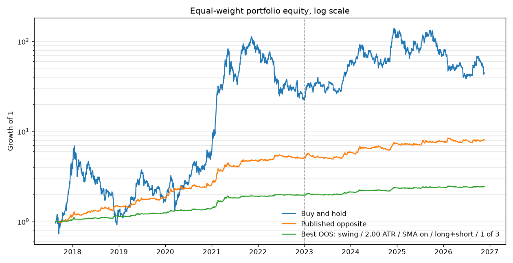

# Round 3

Opposite-signal exit, one position per pair. Fees 0.1% per side, slippage 5 bps,
starting equity 10,000. Sharpe and Sortino use equal-weight daily returns of the
20 series (10 USDT symbols on Binance and KuCoin), risk free rate 0, 365-day year.
Win rate and average R use closed trades only.

Variants tried in this grid: 72. That is 3 stop anchors (mode wick,
trading-block low/high, last confirmed 5-bar swing) × 3 ATR buffers (0.25, 1.0, 2.0)
× SMA filter on or off × long-only or long+short × confluence 1 or 2 of 1w/3d/1d.
The published stop from round 2 is reported separately and is not one of the 72.
Picking the best of 72 out-of-sample Sharpes biases that number upward.

Out of sample, these beat equal-weight buy-and-hold Sharpe: published opposite; swing / 2.00 ATR / SMA on / long+short / 1 of 3; swing / 1.00 ATR / SMA on / long+short / 1 of 3; wick / 2.00 ATR / SMA on / long+short / 1 of 3; swing / 0.25 ATR / SMA on / long+short / 1 of 3; wick / 1.00 ATR / SMA on / long+short / 1 of 3; wick / 0.25 ATR / SMA on / long+short / 1 of 3; wick / 1.00 ATR / SMA on / long+short / 2 of 3; wick / 2.00 ATR / SMA on / long+short / 2 of 3; wick / 0.25 ATR / SMA on / long+short / 2 of 3; swing / 0.25 ATR / SMA on / long+short / 2 of 3; swing / 2.00 ATR / SMA on / long+short / 2 of 3; swing / 1.00 ATR / SMA on / long+short / 2 of 3; wick / 1.00 ATR / SMA off / long+short / 2 of 3; wick / 2.00 ATR / SMA off / long+short / 2 of 3; block / 1.00 ATR / SMA on / long+short / 1 of 3; wick / 2.00 ATR / SMA off / long+short / 1 of 3; block / 0.25 ATR / SMA on / long+short / 2 of 3; block / 1.00 ATR / SMA on / long+short / 2 of 3; wick / 0.25 ATR / SMA off / long+short / 2 of 3; wick / 1.00 ATR / SMA off / long+short / 1 of 3; block / 0.25 ATR / SMA on / long+short / 1 of 3; swing / 2.00 ATR / SMA off / long+short / 2 of 3; swing / 0.25 ATR / SMA off / long+short / 2 of 3.
Published opposite out of sample: return 60.3%, Sharpe 0.92, Sortino 1.43, CAGR 12.9%. Buy and hold: return 97.0%, Sharpe 0.59, Sortino 0.86.
Best of the 72 by out-of-sample Sharpe: swing / 2.00 ATR / SMA on / long+short / 1 of 3. Return 24.5%, Sharpe 1.10, Sortino 1.70, CAGR 5.8%.
In-sample only: swing / 1.00 ATR / SMA off / long+short / 2 of 3; wick / 0.25 ATR / SMA off / long+short / 1 of 3; swing / 2.00 ATR / SMA off / long+short / 1 of 3; swing / 1.00 ATR / SMA off / long+short / 1 of 3; block / 1.00 ATR / SMA off / long+short / 2 of 3; block / 0.25 ATR / SMA off / long+short / 2 of 3; swing / 0.25 ATR / SMA off / long+short / 1 of 3; block / 0.25 ATR / SMA off / long+short / 1 of 3; block / 2.00 ATR / SMA on / long+short / 2 of 3; block / 2.00 ATR / SMA off / long+short / 2 of 3; block / 2.00 ATR / SMA on / long+short / 1 of 3; block / 2.00 ATR / SMA off / long+short / 1 of 3.

## Why baseline closed trades win about 0%

The cited Binance BTC cell is the round-2 baseline (fixed stop or two closes,
one position per direction). A stop beyond the entry can only book a loss,
and the two-close rule fires after price is back inside the broken level,
which is also a loss after fees. Trades that never hit either rule stay open
and are left out of the closed-trade win rate.

Binance BTC, closes in 2017-2022: 27 closed, 0 wins, average R -0.94. Exits: stop 21, two_lower_closes 6.
Of those stop exits, the median hold is 40.00 hours and 8 of 21 close within 24 hours.
Across every baseline stop exit in the round-2 files, 387 of 710 were wick-only (the bar's close finished back beyond the stop), 323 closed through the stop, and 0 had no cached bar. 212 of 710 closed within 24 hours.
The 0.25 ATR buffer is tight enough to turn wicks into losses, and it is not the whole reason the closed-trade win rate is zero: every stop exit is a loss by construction, and the two-close exits in this cell were losses too.

With one position per pair, the same published signals run as baseline close 329 trades in 2017-2022 across the 20 series, win rate 0.0%, average R -1.04.

## Published opposite, per pair

Stop is the round-2 rule: 0.25 ATR beyond the nearer of the mode level and the signal-bar wick. SMA filter on, long and short, at least one of 1w/3d/1d. Closed trades over the whole loaded history. Expectancy is mean R.

| Pair | Closed | Win rate | Avg win R | Avg loss R | Expectancy | Exits | Avg days |
| --- | --- | --- | --- | --- | --- | --- | --- |
| binance BTCUSDT | 363 | 22.6% | 6.71 | -1.04 | 0.71 | opposite_signal 160, stop 203 | 8.60 |
| binance ETHUSDT | 329 | 24.3% | 6.25 | -0.96 | 0.79 | opposite_signal 160, stop 169 | 9.48 |
| binance SOLUSDT | 226 | 23.9% | 8.68 | -0.95 | 1.35 | opposite_signal 110, stop 116 | 9.29 |
| binance ARBUSDT | 143 | 22.4% | 4.02 | -0.96 | 0.16 | opposite_signal 61, stop 82 | 8.41 |
| binance BNBUSDT | 361 | 21.6% | 11.23 | -0.97 | 1.66 | opposite_signal 179, stop 182 | 8.40 |
| binance XRPUSDT | 361 | 17.7% | 4.63 | -0.99 | 0.01 | opposite_signal 150, stop 211 | 7.85 |
| binance ADAUSDT | 350 | 21.4% | 5.48 | -0.91 | 0.46 | opposite_signal 170, stop 180 | 8.18 |
| binance DOGEUSDT | 262 | 23.7% | 6.75 | -1.06 | 0.79 | opposite_signal 124, stop 138 | 9.33 |
| binance AVAXUSDT | 227 | 19.4% | 9.64 | -0.93 | 1.12 | opposite_signal 105, stop 122 | 8.90 |
| binance LINKUSDT | 337 | 19.9% | 5.47 | -0.94 | 0.33 | opposite_signal 153, stop 184 | 7.68 |
| kucoin BTCUSDT | 372 | 21.2% | 6.53 | -1.03 | 0.57 | opposite_signal 172, stop 200 | 8.14 |
| kucoin ETHUSDT | 310 | 25.5% | 6.03 | -0.97 | 0.81 | opposite_signal 148, stop 162 | 9.87 |
| kucoin SOLUSDT | 193 | 22.8% | 5.38 | -0.91 | 0.52 | opposite_signal 98, stop 95 | 9.08 |
| kucoin ARBUSDT | 144 | 21.5% | 3.87 | -0.98 | 0.07 | opposite_signal 58, stop 86 | 8.41 |
| kucoin BNBUSDT | 283 | 21.6% | 10.79 | -0.98 | 1.56 | opposite_signal 140, stop 143 | 8.72 |
| kucoin XRPUSDT | 346 | 17.1% | 5.28 | -0.99 | 0.08 | opposite_signal 139, stop 207 | 7.40 |
| kucoin ADAUSDT | 325 | 17.2% | 5.00 | -0.95 | 0.08 | opposite_signal 139, stop 186 | 7.36 |
| kucoin DOGEUSDT | 215 | 20.9% | 7.32 | -0.99 | 0.75 | opposite_signal 91, stop 124 | 8.80 |
| kucoin AVAXUSDT | 188 | 21.8% | 7.46 | -0.96 | 0.88 | opposite_signal 87, stop 101 | 10.05 |
| kucoin LINKUSDT | 271 | 18.1% | 4.58 | -0.91 | 0.08 | opposite_signal 130, stop 141 | 7.60 |

Pooled out of sample: closed 3244, win rate 20.0%, average win R 5.51, average loss R -0.97, expectancy 0.32, average days 8.05. Exits: opposite_signal 1491, stop 1753.

## Anchor coverage

Share of the published signal set (SMA on, both directions, one decision timeframe) with a recorded anchor. A wrong-side anchor is still dropped when the stop is placed.

| Anchor | Present | Signals |
| --- | --- | --- |
| wick | 84.9% | 66631 |
| block | 99.9% | 66631 |
| swing | 100.0% | 66631 |

## Ranked by out-of-sample Sharpe

| Rank | Variant | OOS closed | OOS win | OOS avg R | OOS return | OOS Sharpe | OOS Sortino | IS Sharpe | IS return | Flag |
| --- | --- | --- | --- | --- | --- | --- | --- | --- | --- | --- |
|  | published stop | 3244 | 20.0% | 0.32 | 60.3% | 0.92 | 1.43 | 1.82 | 411.2% | beats OOS |
| 1 | swing / 2.00 ATR / SMA on / long+short / 1 of 3 | 2586 | 25.9% | 0.17 | 24.5% | 1.10 | 1.70 | 1.85 | 97.8% | beats OOS |
| 2 | swing / 1.00 ATR / SMA on / long+short / 1 of 3 | 2614 | 25.5% | 0.21 | 30.0% | 1.08 | 1.69 | 1.83 | 124.8% | beats OOS |
| 3 | wick / 2.00 ATR / SMA on / long+short / 1 of 3 | 2615 | 25.3% | 0.25 | 36.1% | 1.08 | 1.70 | 1.93 | 179.0% | beats OOS |
| 4 | swing / 0.25 ATR / SMA on / long+short / 1 of 3 | 2662 | 25.0% | 0.25 | 38.0% | 1.07 | 1.67 | 1.83 | 155.3% | beats OOS |
| 5 | wick / 1.00 ATR / SMA on / long+short / 1 of 3 | 2804 | 23.2% | 0.31 | 49.4% | 1.04 | 1.62 | 1.91 | 265.9% | beats OOS |
| 6 | wick / 0.25 ATR / SMA on / long+short / 1 of 3 | 3204 | 19.9% | 0.38 | 73.7% | 1.01 | 1.58 | 1.94 | 518.5% | beats OOS |
| 7 | wick / 1.00 ATR / SMA on / long+short / 2 of 3 | 1774 | 22.3% | 0.46 | 46.6% | 0.98 | 1.49 | 1.58 | 188.9% | beats OOS |
| 8 | wick / 2.00 ATR / SMA on / long+short / 2 of 3 | 1605 | 24.7% | 0.37 | 33.4% | 0.97 | 1.48 | 1.57 | 135.9% | beats OOS |
| 9 | wick / 0.25 ATR / SMA on / long+short / 2 of 3 | 2109 | 17.9% | 0.53 | 62.8% | 0.94 | 1.43 | 1.68 | 363.4% | beats OOS |
| 10 | swing / 0.25 ATR / SMA on / long+short / 2 of 3 | 1603 | 24.6% | 0.36 | 29.8% | 0.94 | 1.42 | 1.46 | 105.6% | beats OOS |
| 11 | swing / 2.00 ATR / SMA on / long+short / 2 of 3 | 1534 | 25.6% | 0.23 | 18.8% | 0.88 | 1.31 | 1.45 | 75.5% | beats OOS |
| 12 | swing / 1.00 ATR / SMA on / long+short / 2 of 3 | 1568 | 25.0% | 0.28 | 22.8% | 0.88 | 1.31 | 1.47 | 93.5% | beats OOS |
| 13 | wick / 1.00 ATR / SMA off / long+short / 2 of 3 | 3350 | 26.3% | 0.26 | 40.5% | 0.77 | 1.17 | 1.41 | 171.4% | beats OOS |
| 14 | wick / 2.00 ATR / SMA off / long+short / 2 of 3 | 3133 | 28.2% | 0.18 | 27.5% | 0.76 | 1.14 | 1.42 | 122.5% | beats OOS |
| 15 | block / 1.00 ATR / SMA on / long+short / 1 of 3 | 2043 | 21.8% | 0.33 | 35.3% | 0.73 | 1.14 | -0.34 | n/a | beats OOS |
| 16 | wick / 2.00 ATR / SMA off / long+short / 1 of 3 | 5595 | 30.4% | 0.08 | 23.0% | 0.71 | 1.12 | 1.71 | 163.1% | beats OOS |
| 17 | block / 0.25 ATR / SMA on / long+short / 2 of 3 | 1667 | 19.6% | 0.45 | 36.3% | 0.70 | 1.07 | 1.76 | 313.8% | beats OOS |
| 18 | block / 1.00 ATR / SMA on / long+short / 2 of 3 | 1557 | 21.6% | 0.37 | 30.7% | 0.69 | 1.04 | 1.40 | 126.0% | beats OOS |
| 19 | wick / 0.25 ATR / SMA off / long+short / 2 of 3 | 3892 | 21.7% | 0.33 | 49.5% | 0.68 | 1.03 | 1.49 | 321.6% | beats OOS |
| 20 | wick / 1.00 ATR / SMA off / long+short / 1 of 3 | 5855 | 28.9% | 0.12 | 31.6% | 0.67 | 1.05 | 1.66 | 245.8% | beats OOS |
| 21 | block / 0.25 ATR / SMA on / long+short / 1 of 3 | 2160 | 19.5% | 0.33 | 35.6% | 0.63 | 0.98 | 1.57 | 332.9% | beats OOS |
| 22 | swing / 2.00 ATR / SMA off / long+short / 2 of 3 | 3096 | 28.7% | 0.11 | 15.4% | 0.62 | 0.91 | 1.30 | 71.3% | beats OOS |
| 23 | swing / 0.25 ATR / SMA off / long+short / 2 of 3 | 3165 | 26.8% | 0.15 | 22.4% | 0.59 | 0.89 | 1.30 | 111.1% | beats OOS |
| 24 | swing / 1.00 ATR / SMA off / long+short / 2 of 3 | 3145 | 27.8% | 0.12 | 16.4% | 0.53 | 0.79 | 1.36 | 95.4% | IS only |
| 25 | block / 0.25 ATR / SMA on / long only / 1 of 3 | 102 | 0.0% | -1.16 | 58.4% | 0.51 | 0.74 | 0.99 | 447.2% |  |
| 26 | wick / 0.25 ATR / SMA on / long only / 1 of 3 | 89 | 0.0% | -1.08 | 61.8% | 0.51 | 0.74 | 0.94 | 405.5% |  |
| 27 | wick / 0.25 ATR / SMA off / long only / 1 of 3 | 100 | 0.0% | -1.09 | 60.7% | 0.51 | 0.73 | 0.95 | 422.0% |  |
| 28 | block / 0.25 ATR / SMA off / long only / 1 of 3 | 109 | 0.0% | -1.26 | 56.9% | 0.51 | 0.73 | 0.98 | 443.3% |  |
| 29 | wick / 0.25 ATR / SMA off / long+short / 1 of 3 | 6592 | 24.8% | 0.13 | 31.9% | 0.50 | 0.79 | 1.60 | 444.9% | IS only |
| 30 | swing / 2.00 ATR / SMA off / long+short / 1 of 3 | 5660 | 30.5% | 0.05 | 11.8% | 0.50 | 0.76 | 1.37 | 78.9% | IS only |
| 31 | wick / 0.25 ATR / SMA off / long only / 2 of 3 | 125 | 0.0% | -1.11 | 51.7% | 0.49 | 0.70 | 1.01 | 425.8% |  |
| 32 | wick / 1.00 ATR / SMA on / long only / 1 of 3 | 75 | 0.0% | -1.05 | 51.1% | 0.48 | 0.69 | 0.81 | 231.7% |  |
| 33 | wick / 1.00 ATR / SMA off / long only / 1 of 3 | 82 | 0.0% | -1.05 | 50.5% | 0.48 | 0.68 | 0.81 | 228.9% |  |
| 34 | block / 1.00 ATR / SMA on / long only / 1 of 3 | 76 | 0.0% | -1.15 | 49.0% | 0.47 | 0.68 | 0.82 | 231.3% |  |
| 35 | wick / 0.25 ATR / SMA on / long only / 2 of 3 | 103 | 0.0% | -1.09 | 48.3% | 0.47 | 0.68 | 0.93 | 318.5% |  |
| 36 | block / 1.00 ATR / SMA off / long only / 1 of 3 | 83 | 0.0% | -1.19 | 48.1% | 0.47 | 0.67 | 0.82 | 230.1% |  |
| 37 | wick / 1.00 ATR / SMA off / long only / 2 of 3 | 88 | 0.0% | -1.06 | 44.4% | 0.47 | 0.67 | 0.92 | 285.4% |  |
| 38 | block / 0.25 ATR / SMA on / long only / 2 of 3 | 78 | 0.0% | -1.16 | 40.9% | 0.46 | 0.66 | 0.82 | 192.6% |  |
| 39 | wick / 1.00 ATR / SMA on / long only / 2 of 3 | 70 | 0.0% | -1.06 | 43.1% | 0.46 | 0.66 | 0.86 | 229.4% |  |
| 40 | swing / 1.00 ATR / SMA off / long+short / 1 of 3 | 5699 | 29.8% | 0.06 | 13.9% | 0.46 | 0.70 | 1.46 | 111.9% | IS only |
| 41 | block / 0.25 ATR / SMA off / long only / 2 of 3 | 87 | 0.0% | -1.29 | 39.4% | 0.45 | 0.65 | 0.81 | 188.0% |  |
| 42 | wick / 2.00 ATR / SMA on / long only / 1 of 3 | 67 | 0.0% | -1.04 | 42.5% | 0.45 | 0.64 | 0.73 | 156.1% |  |
| 43 | wick / 2.00 ATR / SMA off / long only / 1 of 3 | 69 | 0.0% | -1.03 | 42.4% | 0.45 | 0.64 | 0.73 | 157.3% |  |
| 44 | wick / 2.00 ATR / SMA on / long only / 2 of 3 | 58 | 0.0% | -1.04 | 39.1% | 0.45 | 0.64 | 0.77 | 156.4% |  |
| 45 | swing / 0.25 ATR / SMA off / long only / 1 of 3 | 45 | 0.0% | -1.03 | 40.0% | 0.45 | 0.64 | 0.74 | 157.4% |  |
| 46 | block / 2.00 ATR / SMA off / long only / 1 of 3 | 74 | 0.0% | -1.23 | 42.5% | 0.45 | 0.64 | 0.75 | 168.2% |  |
| 47 | swing / 0.25 ATR / SMA on / long only / 1 of 3 | 50 | 0.0% | -1.03 | 39.7% | 0.45 | 0.64 | 0.74 | 157.6% |  |
| 48 | wick / 2.00 ATR / SMA off / long only / 2 of 3 | 68 | 0.0% | -1.04 | 38.3% | 0.44 | 0.63 | 0.78 | 162.0% |  |
| 49 | block / 2.00 ATR / SMA on / long only / 1 of 3 | 71 | 0.0% | -1.24 | 41.1% | 0.44 | 0.63 | 0.76 | 169.1% |  |
| 50 | swing / 2.00 ATR / SMA off / long only / 1 of 3 | 29 | 0.0% | -1.02 | 33.9% | 0.44 | 0.63 | 0.67 | 101.4% |  |
| 51 | swing / 1.00 ATR / SMA off / long only / 1 of 3 | 37 | 0.0% | -1.02 | 37.4% | 0.44 | 0.63 | 0.71 | 132.9% |  |
| 52 | swing / 1.00 ATR / SMA on / long only / 1 of 3 | 46 | 0.0% | -1.02 | 36.8% | 0.44 | 0.62 | 0.71 | 132.6% |  |
| 53 | swing / 2.00 ATR / SMA on / long only / 1 of 3 | 42 | 0.0% | -1.02 | 33.4% | 0.43 | 0.62 | 0.67 | 101.1% |  |
| 54 | block / 1.00 ATR / SMA on / long only / 2 of 3 | 55 | 0.0% | -1.12 | 33.4% | 0.42 | 0.60 | 0.68 | 109.4% |  |
| 55 | block / 2.00 ATR / SMA off / long only / 2 of 3 | 53 | 0.0% | -1.14 | 32.2% | 0.42 | 0.60 | 0.61 | 79.2% |  |
| 56 | block / 1.00 ATR / SMA off / long only / 2 of 3 | 66 | 0.0% | -1.17 | 32.4% | 0.42 | 0.59 | 0.69 | 116.2% |  |
| 57 | swing / 2.00 ATR / SMA off / long only / 2 of 3 | 37 | 0.0% | -1.02 | 25.5% | 0.41 | 0.57 | 0.56 | 61.0% |  |
| 58 | swing / 2.00 ATR / SMA on / long only / 2 of 3 | 36 | 0.0% | -1.02 | 25.7% | 0.40 | 0.57 | 0.56 | 60.7% |  |
| 59 | swing / 1.00 ATR / SMA off / long only / 2 of 3 | 41 | 0.0% | -1.03 | 27.7% | 0.40 | 0.57 | 0.62 | 83.1% |  |
| 60 | swing / 0.25 ATR / SMA on / long only / 2 of 3 | 44 | 0.0% | -1.03 | 28.7% | 0.40 | 0.57 | 0.63 | 86.0% |  |
| 61 | swing / 1.00 ATR / SMA on / long only / 2 of 3 | 40 | 0.0% | -1.02 | 27.9% | 0.40 | 0.57 | 0.61 | 78.7% |  |
| 62 | block / 2.00 ATR / SMA on / long only / 2 of 3 | 50 | 0.0% | -1.13 | 28.3% | 0.40 | 0.56 | 0.62 | 80.1% |  |
| 63 | swing / 0.25 ATR / SMA off / long only / 2 of 3 | 49 | 0.0% | -1.08 | 28.0% | 0.40 | 0.57 | 0.63 | 87.9% |  |
| 64 | block / 1.00 ATR / SMA off / long+short / 2 of 3 | 2153 | 22.2% | 0.14 | 8.3% | 0.22 | 0.33 | 1.13 | 113.7% | IS only |
| 65 | block / 0.25 ATR / SMA off / long+short / 2 of 3 | 2036 | 20.0% | 0.20 | 6.4% | 0.18 | 0.24 | 1.47 | 244.7% | IS only |
| 66 | swing / 0.25 ATR / SMA off / long+short / 1 of 3 | 5701 | 28.9% | 0.03 | 3.7% | 0.14 | 0.21 | 1.40 | 143.2% | IS only |
| 67 | block / 1.00 ATR / SMA off / long+short / 1 of 3 | 3069 | 23.0% | 0.04 | 0.1% | 0.07 | 0.10 | -0.35 | n/a |  |
| 68 | block / 0.25 ATR / SMA off / long+short / 1 of 3 | 2801 | 20.6% | 0.02 | -3.5% | 0.03 | 0.05 | 1.38 | 289.4% | IS only |
| 69 | block / 2.00 ATR / SMA on / long+short / 2 of 3 | 1449 | 23.3% | 0.03 | -5.1% | 0.02 | 0.02 | 1.36 | 89.4% | IS only |
| 70 | block / 2.00 ATR / SMA off / long+short / 2 of 3 | 2266 | 23.8% | -0.02 | -14.1% | -0.12 | -0.13 | 1.12 | 71.8% | IS only |
| 71 | block / 2.00 ATR / SMA on / long+short / 1 of 3 | 2064 | 23.6% | 0.11 | n/a | -0.48 | -0.49 | 1.51 | 130.8% | IS only |
| 72 | block / 2.00 ATR / SMA off / long+short / 1 of 3 | 3360 | 24.6% | -2.43 | 72.3% | -0.69 | -0.69 | 1.21 | 105.2% | IS only |

## Equity curve

Log scale, growth of 1. The dashed line is 2023-01-01. Buy and hold is the same equal-weight daily-return book.

